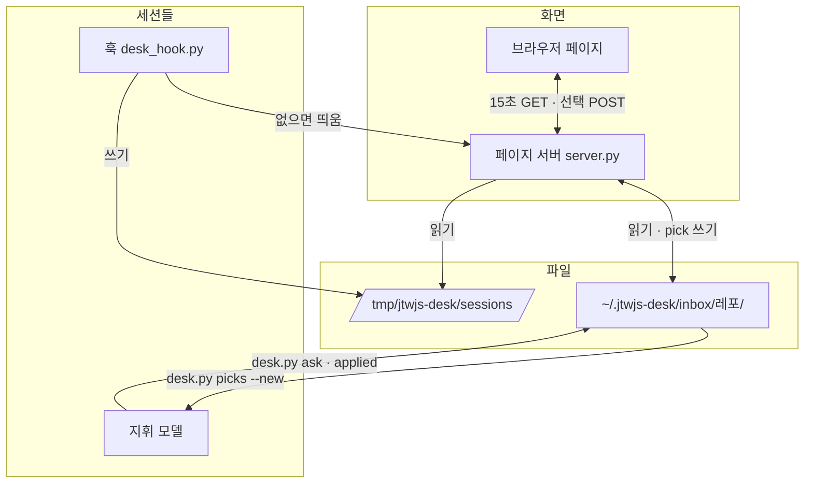
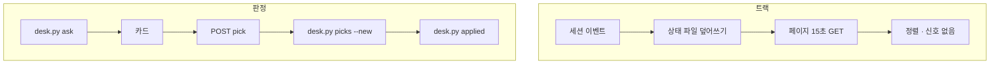

# ARCHITECTURE: 지휘 책상

## 키워드

| 용어 | 이 문서에서의 뜻 |
|---|---|
| 훅 | Claude Code가 세션 이벤트마다 부르는 명령. 여기서는 `hooks/desk_hook.py` 하나 |
| 상태 파일 | 세션 하나의 현재 상태 JSON. 훅만 쓴다 |
| 판정 파일 | 지휘가 올린 질문 하나(`<id>.json`)와 그 선택(`.pick.json`) · 반영(`.applied.json`) |
| 페이지 서버 | 127.0.0.1에서 페이지와 JSON을 내주고 선택을 받아 저장하는 프로세스. `page/server.py` |
| desk 스크립트 | 지휘가 Bash로 부르는 CLI. 판정을 올리고, 새 선택만 읽고, 반영을 찍는다. `scripts/desk.py` |
| 신호 없음 | 작업 중인데 마지막 활동이 10분을 넘은 세션. 페이지 서버가 GET 때마다 계산한다 |

## 개요

모델은 판정 질문을 쓰고 선택을 읽을 때만 토큰을 쓴다. 트랙 상태 수집(훅) · 화면(브라우저) · 선택 저장(페이지 서버) · 걸러 읽기(desk 스크립트)는 모델 밖에서 돈다.

## 계층 배치

| 층 | 책임 | 하지 않는 것 |
|---|---|---|
| `hooks/desk_hook.py` | 이벤트 → 상태 파일 덮어쓰기 · SessionStart에 서버 확인 · 승인 대기 ntfy | stdout 출력 · 판정 파일 접근 · 네트워크 대기(ntfy는 떼어서 보낸다) |
| `scripts/desk.py` | 판정 파일 쓰기(ask · applied) · 새 선택만 출력 · 정리 | 화면 · 세션 상태 |
| `page/server.py` | 페이지 · 상태 JSON 제공(정렬 · 신호 없음 계산 포함) · pick 저장 · 버전 응답 | 판정 질문 쓰기 · 반영 찍기 |
| `page/index.html` | 탭 둘 · 받은 순서대로 그리기 · "n분 전" 표시 · 선택 POST | 정렬 · 신호 없음 판단 · 저장 규칙 |
| `desk/` (공용 모듈) | 파일 경로 · 원자적 쓰기 · 형식 검증 · 정렬 규칙 | 입출력 대기 |
| `skills/decision-inbox/SKILL.md` | 지휘가 판정을 올리고 읽는 절차 | 코드 |

## 데이터 흐름

- 상태 파일 하나 = 세션 하나. 다른 세션 파일을 건드리지 않아서 잠금이 없다
- 판정 질문 · 선택 · 반영은 쓰는 주체가 달라 파일을 나눈다(지휘 · 서버 · 지휘)
- 모든 쓰기는 같은 폴더 임시 파일에 쓴 뒤 `os.replace`(원자적 교체). 읽는 쪽이 반쯤 쓴 파일을 보지 않는다

## 경계 · 의존 방향

- `hooks/` · `scripts/` · `page/` → `desk/`만 import. 셋은 서로 import하지 않는다
- 하네스(claude-harness)는 이 레포를 import하지 않는다. 지휘 스킬은 `desk.py`를 명령으로만 부른다(후속, 이번 범위 밖)
- 외부 패키지 없음. Python 표준 라이브러리만

## 상태 관리 규약

- 세션 상태 값: `승인 대기` · `작업 중` · `입력 대기`. `신호 없음`은 저장하지 않고 페이지 서버가 GET 때마다 `작업 중 + now - lastAt > 10분`으로 계산한다(`desk/` 순수 함수, 시각은 인자로 받는다)
- 상태 파일은 SessionEnd에 지운다. 지워지지 않은 파일(강제 종료)은 페이지 서버가 24시간 지나면 지운다
- 판정 id는 지휘가 정한다. 같은 id로 다시 ask하면 거절한다(덮어쓰지 않는다)

## 테스트 전략

- `desk/` 순수 함수(이벤트 → 상태 · 정렬 · 형식 검증 · 새 선택 거르기)는 단위 테스트
- 기능당 통합 테스트 하나씩: 훅을 가짜 이벤트 JSON으로 실행해 상태 파일과 빈 stdout 확인 · 서버를 임시 포트로 띄워 GET/POST(토큰 · Origin 거절 포함) · desk.py ask → pick → picks --new → applied 한 바퀴
- 화면(`index.html`)은 자동 테스트하지 않는다. 판단은 전부 서버 쪽 순수 함수에 있고, 화면은 수동 확인 목록(목업의 칸이 다 보이나)으로 본다
- 파일 경로는 환경 변수(`DESK_HOME` · `DESK_RUN`)로 바꿀 수 있게 해 테스트가 임시 폴더를 쓴다
