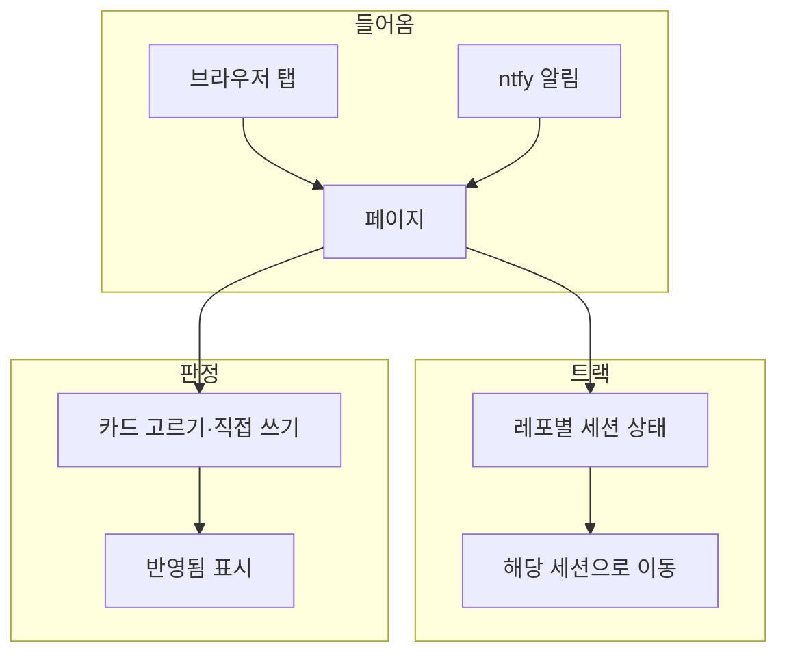

# PRD: 지휘 책상 (판정 대기함 v2 + 트랙 현황)

## 날것

지휘 세션으로 레포 여럿을 병렬 트랙으로 돌리는데, 트랙이 지금 뭘 하는지 안 보이고, 판정 대기함(claude.ai 아티팩트)은 고를 선택지가 다 별로일 때 직접 쓸 칸이 없다. 메모가 결정보다 커지고, AI가 이미 정한 것이 설명 칸에 묻히고, 고른 게 반영됐는지 모른다. 남이 만든 허브 플러그인을 깔지 않고 내 워크플로에 맞는 도구를 직접 만든다. 토큰은 스크립트로 아낀다.

## 무엇을

맥의 로컬 페이지(127.0.0.1) 하나에 **판정 탭**과 **트랙 탭**을 두고, 훅과 스크립트가 상태를 채워 모델 토큰 없이 보이게 하는 Claude Code 플러그인.

## 왜

진짜 문제: 판정과 트랙 상태가 지휘 모델의 대화를 거쳐야만 오가서, 사람은 안 보이고 모델은 토큰을 쓴다.

| 지표 | 비포 | 목표 |
|---|---|---|
| 지휘가 대신 받아 적은 판정 메모 (직접 쓸 칸이 없어 채팅으로 우회) | 6건 / 126판정 (11-01~11-02, 옛 대기함 db 손 셈) | 0 |
| 반영 표시가 있는 판정 | 0 / 126 (칸 없음) | 고른 판정 전부 |
| AI가 정한 것이 설명 칸에 묻힌 판정 | 6건 | 0 (별도 칸) |
| 지휘가 트랙에 상태를 묻는 메시지 | 미측정: 지휘 세션 기록에서 상태 질문 SendMessage 수 / 구현 전 | 비포보다 적게 |
| 지휘가 판정 결과를 읽을 때 컨텍스트에 들어가는 양 | 미측정: 옛 대기함 db_list 2페이지 출력 크기 / 구현 전 | 비포보다 적게 |
| 훅 1회 실행 시간 | 미측정: 구현 뒤 부하 낮을 때·높을 때 각 5회 / 첫 사용 주 | 정하지 않음 (기록만) |

## 참고 자료

- lcalmsky/deadhd (MIT): 훅이 세션별 상태 JSON을 쓰고, 로컬 페이지가 15초마다 읽어 멈춤을 브라우저에서 계산. 정렬 승인 대기 > 신호 없음 > 입력 대기 > 작업 중 > 완료. 상태 파일 방식과 훅 시점을 이것과 같게 간다
- 설계안 아티팩트 「판정 대기함 v2 설계안」: v2 카드 목업(직접 쓰기 · AI가 정한 것 · 메모 종류 · 반영됨 · 전제 열림)과 트랙 탭 목업. 이 페이지의 시안으로 쓴다
- 옛 판정 대기함 아티팩트: 126판정 · 126선택 · 메모 22. 손대지 않고 기록으로 둔다

## 사용자 시나리오

1. Finn이 맥에서 Claude 세션을 연다 → 페이지 서버가 없으면 뜬다 → 브라우저 탭에서 레포별 트랙 상태를 본다
2. 트랙 세션이 승인을 기다린다 → 폰에 ntfy 알림 → 맥에서 그 세션으로 간다
3. 지휘가 판정 질문을 올린다 → 판정 탭에 카드가 뜬다 → 선택지를 누르거나 직접 쓴다 → 지휘가 스크립트로 새 선택만 읽어 반영한다 → 카드에 반영됨 · 이슈 링크가 붙는다
4. 세션이 10분 넘게 신호가 없다 → 트랙 탭에서 💤로 위로 올라온다

## 사용자 흐름

진입 경로: 브라우저 탭(고정) · ntfy 알림. 동선: 트랙 탭에서 이상 신호 확인 → 판정 탭에서 고르기. 끝: 선택 저장(판정) 또는 해당 세션으로 이동(트랙).

개인화: 해당 없음. 쓰는 사람이 Finn 한 명이다.

## 범위

포함
- 훅: 세션 상태 파일 쓰기(deadhd와 같은 시점, 도구 사용마다 포함) · 승인 대기 ntfy 알림 · 세션 시작 때 페이지 서버 확인과 실행
- 로컬 페이지: 트랙 탭 · 판정 탭, 레포(프로젝트)별 구분
- 판정 파일 형식과 스크립트: 지휘가 질문을 쓰고, 새 선택만 읽고, 반영을 찍는다
- 오래된 판정 파일 정리

하지 않을 것
- 폰에서 판정하기, 폰에서 트랙 보기: Tailscale 전까지. 써 보고 필요하면 그때
- claude.ai 아티팩트: 판정 화면을 아티팩트에 올리지 않는다
- 옛 대기함 126건 가져오기: 기록으로 둔다
- 하네스 지휘 스킬 수정: 이 플러그인이 동작한 뒤 하네스 쪽에서 한 줄 연결
- launchd 상시 실행: 플러그인 업데이트 때 경로가 바뀐다
- 외부 패키지: Python 표준 라이브러리만

## 결정

| 주제 | 목적·이유 | 결정 | 결정 주체 | 버린 방법 |
|---|---|---|---|---|
| desk-own-tool | 남이 만든 허브에 맞추지 않고 내 워크플로에 맞춘다 | 직접 만든다 (B3) | Finn | deadhd 설치 후 지휘가 채우기 (B2): 내 도구가 아니게 됨. 아티팩트 트랙 탭 (B1): 갱신마다 모델 토큰 |
| desk-separate-repo | 하네스 훅은 모든 세션에서 돈다. 도구를 따로 켜고 끄고 릴리스한다 | 별도 플러그인 레포 jtwjs-desk | Finn | 하네스 안에 두기 |
| desk-phone-scope | 폰 접근은 사설망이 필요하다 | 폰은 ntfy 알림만. 판정·트랙은 맥 로컬 페이지 | Finn | 판정만 아티팩트에 두기: 아티팩트 작업과 MCP 읽기 토큰이 남음 |
| desk-storage | 동시에 쓰는 훅끼리 안 겹친다 | JSON 파일 여러 개(deadhd 방식). 트랙은 /tmp, 판정은 홈 폴더 | Finn (위치는 AI 추천 수용) | SQLite: 동시 쓰기 잠금. 판정도 /tmp + ADR에서 복원: 11-01 이후 ADR 2개 vs 판정 126건이라 복원 불가 |
| desk-hook-timing | 멈춤 판정에 마지막 활동 시각이 필요하다 | deadhd와 같이 도구 사용마다 찍는다 | Finn | 턴 경계만: 긴 턴이 멈춤과 구분 안 됨 |
| desk-server-lifecycle | 플러그인 경로는 버전마다 바뀐다 | 아무 세션의 SessionStart 훅이 서버가 없거나 버전이 다르면 띄운다 | AI 추천 수용 | launchd 상시: 업데이트 때 옛 경로 |
| desk-repick | 잘못 누른 선택을 채팅 우회 없이 고친다. 반영된 뒤 바뀌면 이슈와 화면이 어긋난다 | 반영 전까지는 다시 고를 수 있고, 반영되면 잠긴다 | Finn | 한 번 고르면 끝(채팅 우회가 돌아옴) · 언제든 다시(이슈와 어긋남) |
| desk-language | 훅은 설치 없이 빨리 떠야 한다 | Python 표준 라이브러리 | Finn (이유 미기록) | Node + TS · 섞기 |

## 수용 조건

트랙
- [ ] 세션이 시작될 때 페이지 서버가 없으면 127.0.0.1의 정해진 포트에서 페이지가 응답한다
- [ ] 서버가 이미 떠 있으면 새로 띄우지 않는다 (세션 둘이 동시에 열려도 서버 프로세스는 하나)
- [ ] 떠 있는 서버의 버전이 플러그인 버전과 다르면 새 버전으로 바꿔 띄운다
- [ ] 훅 이벤트(프롬프트 · 도구 사용 · 승인 대기 · 턴 끝 · 압축)마다 그 세션의 상태 파일이 레포 · 브랜치 · 상태 · 마지막 시각으로 갱신된다
- [ ] 세션이 끝나면 그 상태 파일이 사라진다
- [ ] 훅은 stdout에 아무것도 내지 않는다 (모델 컨텍스트 0)
- [ ] 승인 대기가 되면 ntfy 토픽 파일이 있을 때만 알림을 보낸다. 본문에는 레포 이름과 상태만 있고 대화 내용은 없다
- [ ] 트랙 탭은 레포별로 묶이고, 승인 대기 > 신호 없음 > 입력 대기 > 작업 중 > 완료 순으로 정렬된다
- [ ] 마지막 활동이 10분을 넘은 작업 중 세션은 신호 없음(💤)으로 보인다. 페이지는 15초마다 다시 읽는다

판정
- [ ] 지휘가 판정 파일을 쓰면 판정 탭에 카드가 뜬다: 질문 · 이유 · 선택지(지휘 권장 표시) · AI가 정한 것(별도 칸) · 전제 열림 표시
- [ ] 선택지를 누르거나 직접 쓰기 칸에 답을 쓰면 선택 파일이 저장된다 (선택 또는 직접 답 · 메모 · 메모 종류 이유/범위 바꿈/새 일 · 반려한 AI 결정)
- [ ] 반영 전인 판정은 다시 고르면 선택 파일이 새 선택으로 바뀌고, 반영된 판정은 화면에서 잠기며 저장 요청도 거절된다
- [ ] 페이지 토큰이 없거나 Origin이 다른 저장 요청은 거절되고 아무것도 저장되지 않는다
- [ ] 스크립트 하나로 레포별 "아직 반영 안 된 선택"만 출력된다
- [ ] 반영 파일이 있으면 카드에 반영됨 · 이슈 링크가 보인다
- [ ] 반영된 지 정한 기간이 지난 판정은 파일이 정리된다

## 남은 ⚠️

- ⚠️ 정리 기간(반영 뒤 며칠): 막지 않음. 계획 단계에서 정한다
- ~~포트 번호 · 페이지 토큰 전달 방식~~ → ADR-003(포트 47615 · bind로 단일 실행) · ADR-004(토큰 + Origin + Host)
- ~~ntfy 토픽~~ → ADR-005(routine과 따로)
