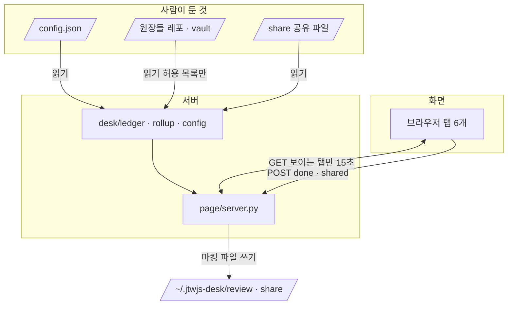
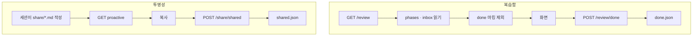

# ARCHITECTURE: 지휘 책상 확장 — 복습함 · 3역량 · 주간 롤업 · 레포 건강도

> 11-03 설계([ARCHITECTURE](../desk-2026-11-03/ARCHITECTURE.md))에 더하는 문서다. 훅 · 상태 파일 · 판정 · 토큰 · 서버 수명은 그대로이고 여기서 다시 쓰지 않는다. 바뀐 것만 쓴다.

## 키워드

| 용어 | 이 문서에서의 뜻 |
|---|---|
| 원장 | desk가 읽기만 하는, 이미 다른 도구가 쓴 파일. `observations.md` · `_learn/inbox.md` · `phases/*/index.json` · `friction/index.md` · `ai-readiness-score.json` · 일간 JSON · 공유 파일 |
| 설정 파일 | `~/.config/jtwjs-desk/config.json`. 레포 목록 · vault 경로를 desk에 알려준다(ADR-008) |
| 읽기 허용 목록 | 서버가 열어도 되는 원장 경로의 고정 목록. 목록 밖 경로는 열지 않는다(ADR-009) |
| 마킹 파일 | 사람이 화면에서 누른 결과. 복습 끝 `<key>.done.json` · 공유 끝 `<id>.shared.json`. 서버가 쓴다(ADR-011) |

## 개요

새 탭 4개는 전부 "원장을 읽어 보여주는 창구"다. 새 수집기도, 모델 호출도, 훅 변경도 없다. 서버가 GET을 받을 때마다 원장을 열어 순수 함수로 행을 만들어 내주고, 화면은 그리기만 한다. 쓰는 것은 마킹 파일 둘뿐이다.

## 계층 배치



| 층 | 바뀐 책임 | 하지 않는 것 |
|---|---|---|
| `desk/config.py` (신규) | 설정 파일 읽기 · `~` 펼치기 · 없으면 `conductor.json` 폴백 · 검증 | 쓰기 · 레포 자동 추가 |
| `desk/ledger.py` (신규) | 원장 텍스트 → 행(순수 함수). observations · friction · inbox 카드 · phases · score · 카드 분류(FE/BE/infra/도메인) | 파일 열기(텍스트를 인자로 받는다) · 정렬 외 판단 |
| `desk/rollup.py` (신규) | 일간 JSON 7개 → 합계 · 레포별 진행(순수 함수) | 파일 열기 |
| `page/server.py` | 엔드포인트 6 GET + 2 POST 추가 · 허용 목록 안에서 파일 열기 · 마킹 파일 쓰기 | 캐시 · 원장 쓰기 · 다른 프로세스 실행 |
| `page/index.html` | 탭 4개 추가 · 3역량 안의 서브 탭 · 마킹 버튼 | 파싱 · 정렬 · 저장 규칙 |
| `hooks/` · `scripts/desk.py` | **변경 없음** | |

## 엔드포인트

모두 기존 보호(ADR-004: Host 확인, POST는 토큰 + Origin)를 그대로 받는다.

| 메서드 · 경로 | 내주는 것 | 만족시키는 수용 조건 |
|---|---|---|
| `GET /review` | 건너뛴 이해증명 작업 + `vault:` 빈 카드. 레포 횡단, `done` 마킹 있는 것 제외 | 복습함 1 · 2 · 3 |
| `GET /competency/workflow` | observations 「열린 것」 + friction `열림` · `보류` 행. 횟수 내림차순, 3회+ 표시 | AI워크플로우 1 · 2 · 3 |
| `GET /competency/proactive` | CPO 기준 원문(설정의 `criteria_file`) · 스피드 소요시간 · 임팩트 링크 · 미반영 공유 파일 | 적극성 1~6 |
| `GET /competency/fullstack` | inbox 기술 · 도메인 카드를 FE/BE/infra/도메인별로 묶고 복습 순서 | 풀스택 1 · 2 |
| `GET /weekly` | 최근 7일 일간 JSON 집계. 없는 날은 "없음"으로 센다 | 주간 롤업 2 |
| `GET /repo-health` | 레포별 최신 점수 · 등급 · 채점일 · "n일 전" · 없으면 "채점 없음" | 레포 건강도 2 |
| `POST /review/done` | 복습 끝 마킹 `{repo, key}` | 복습함 3 |
| `POST /share/shared` | 공유 끝 마킹 `{repo, id}` | 적극성 6 |

- 응답에는 설정 문제를 같이 싣는다: `config: {source: "config"|"conductor"|"none", unregistered: [레포 이름…]}`. 화면은 이것을 각 탭 위에 한 줄로 그린다
- 읽을 파일이 없는 레포는 행을 빼지 않고 `{repo, missing: "경로 없음"|"파일 없음"}`으로 낸다. 조용히 비어 보이는 것이 이 확장에서 가장 큰 위험이라서다

## UI 배치

```
[트랙] [판정] [복습함] [3역량] [주간 롤업] [레포 건강도]      ← 상단 탭 6개
                        └ [AI워크플로우] [적극성] [풀스택]    ← 3역량 안 서브 탭
```

- **적극성**은 위에서 아래로: CPO 기준 메모(항상 펼침) → 스피드(①소요시간 ②"측정 안 함" ③AI워크플로우 링크만) → 임팩트(①PRD 왜 링크 ②최근 갱신분) → 투명성(미반영 공유 파일 + 복사 · 공유함 버튼)
- **복습함**과 **풀스택**은 같은 `_learn/inbox.md` 카드를 읽지만 목적이 다르다. 복습함은 `vault:` 빈 카드 + 건너뛴 작업을 "해야 할 것"으로, 풀스택은 영역별 "어디가 약한가"로 보인다
- 화면은 탭을 열었을 때와 열려 있는 동안 15초마다만 그 탭의 엔드포인트를 부른다. 안 보이는 탭의 원장은 열지 않는다

## 데이터 흐름



- 항목 키: 작업은 `phase-<task>`, 카드는 `card-<제목 sha1 앞 8자>`. 카드 제목을 고치면 키가 바뀌어 다시 뜬다(알려진 한계, ADR-011)
- 마킹 파일 경로: `~/.jtwjs-desk/review/<레포>/<key>.done.json` · `~/.jtwjs-desk/share/<레포>/<id>.shared.json`. 쓰기는 11-03과 같이 임시 파일 + `os.replace`

## 읽기 규약

- 설정 파일 키: `repos`(경로 목록) · `vault`(경로) · `criteria_file`(CPO 기준 파일 경로) · `daily_dir`(기본 `~/.claude/daily`) · `evidence_globs`(레포 기준 패턴 목록, 기본 빈 목록). 환경 변수 `DESK_CONFIG`(설정 파일) · `DESK_CONDUCTOR`(폴백 파일)로 경로를 바꿔 테스트가 임시 파일을 쓴다
- 폴백: `config.json`이 없을 때만 `~/.claude/conductor.json`의 `repos` · `seat`(→ `vault`)를 읽는다. 이때 화면 위에 "폴백 사용 중"을 띄운다. `criteria_file`은 폴백이 못 채우므로 적극성의 CPO 메모는 "설정 없음"이 된다
- 읽기 허용 목록(이 밖은 열지 않는다):

  | 대상 | 경로 |
  |---|---|
  | 레포별 | `.claude/observations.md` · `_learn/inbox.md` · `phases/*/index.json` · `.claude/reports/*/ai-readiness-score.json` · 각 phase `docs` 폴더의 `PRD.md`(왜 섹션 링크용) · 설정 `evidence_globs`에 적힌 패턴에 걸린 파일(`..` · 절대경로 패턴은 무시) |
  | vault | `<vault>/1_MyBrain/brain/friction/index.md` 한 파일 |
  | 그 밖 | `criteria_file` · `<daily_dir>/YYYY-MM-DD.json` · `~/.jtwjs-desk/share/` |

  `raw/` · `thread-raw/` · `0_Me/`는 허용 목록에 없어서 열 방법이 없다
- 읽은 내용은 응답으로만 나간다. 상태 파일 · 로그 · 마킹 파일에는 쓰지 않는다
- `desk/`와 `page/`는 다른 프로세스를 실행하지 않는다(`subprocess` · `os.system` · `Popen` 없음). 훅의 서버 기동용 `Popen`은 이미 있는 것이고 이 규칙의 대상이 아니다

## 경계 · 의존 방향

- 11-03 규칙 그대로: `hooks/` · `scripts/` · `page/` → `desk/`만 import. 외부 패키지 없음
- `desk/config.py`가 하네스 설정(`conductor.json`)의 스키마를 가정하는 유일한 지점이다. 하네스 → desk import는 여전히 없다
- claude-harness 쪽 변경(reflect 필드 · 일간 JSON · sdd 단계 둘)은 이 레포 범위 밖이고 ADR-012가 desk가 기대하는 모양을 적는다. 구현은 claude-harness에서

## 테스트 전략

- `desk/` 순수 함수 단위 테스트: 설정 읽기(폴백 · 깨진 파일 · `~` 펼치기) · 원장 파서 · 카드 분류 · 7일 집계(빠진 날 포함) · 항목 키
- 통합 테스트: 서버를 임시 포트 · 임시 `DESK_HOME` · 임시 `DESK_CONFIG`로 띄워 엔드포인트마다 GET, POST 둘은 토큰 · Origin 거절 포함, `done` 마킹 후 `/review`에서 사라지는지
- 금지 검사 테스트 하나: `desk/`와 `page/` 소스에 `subprocess` · `os.system` · `Popen`이 없는지 grep(수용 조건 "코드에 subprocess 호출 없음"의 자동화)
- 🔴 픽스처는 전부 지어낸 데이터로 쓴다. 실제 `observations.md` · `inbox.md` · vault 파일을 복사해 넣지 않는다(CRITICAL: 원문 금지)
- 화면은 11-03과 같이 자동 테스트 없이 수동 확인 목록(탭 6개 · 서브 탭 3개 · 각 칸이 다 보이나 · "경로 없음"이 보이나)으로 본다

## 확인 필요

- 원장 파서 형식: `observations.md` · `inbox.md`는 확정(ADR-013). friction 행은 실제 파일이 이 머신에 없어 가정형이다(ADR-013). 실제 파일이 생기면 파서와 픽스처를 한 번 맞춘다
- ~~`ai-readiness-score.json` 경로~~ 확정(ADR-013): `.claude/reports/<날짜>/` · `docs/` · `.claude/` · 레포 루트 4곳
- ~~`evidence.md` · `cards/` 위치~~ 못 찾음 → 설정 `evidence_globs`로 Finn이 정한다(ADR-008)
- `criteria_file`이 가리킬 CPO 기준 파일에 사람 이름이 들어 있는지. 화면에 그대로 보이므로 Finn이 한 번 열어 본다
