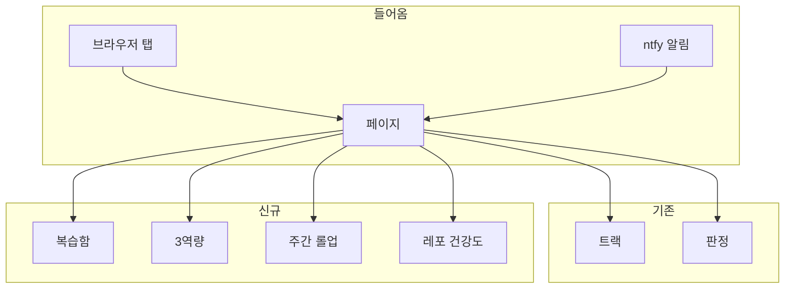

# PRD: 지휘 책상 확장 — 복습함 · 3역량 · 주간 롤업 · 레포 건강도

## 날것

jtwjs-desk를 지금 범위(트랙 탭+판정 탭)에서 더 키워서, 지휘 세션으로 여러 작업을 지휘하는 것뿐 아니라 위키 지식 쌓기·퀴즈·내 말로 풀어보기(이해 증명)·일간/주간 태스크 정리까지 담은 "내 업무 전반을 관리하는 앱"으로 확장하자는 아이디어에서 출발. `why` 인터뷰로 범위를 좁혀, 3역량(AI워크플로우·적극성·풀스택)·복습함·주간 롤업·레포 건강도 4개 메뉴로 수렴했다.

## 무엇을

desk에 메뉴 4종(복습함·3역량[AI워크플로우/적극성/풀스택]·주간 롤업·레포 건강도)을 추가해, 이미 여러 곳에 흩어진 원장(`.claude/observations.md` · vault `friction/index.md` · `_learn/inbox.md` · `~/.claude/learning-level.json` · daily-hub · `ai-readiness-score.json` · `evidence.md` · PRD 왜 섹션)을 레포 횡단으로 읽어 보여주는 창구로 확장한다.

## 왜

진짜 문제: 트랙·판정 신호는 desk에서 보이는데, 성장·복습·공유 신호는 여러 곳에 따로따로 쌓여서 한눈에 안 보이고, 매번 레포마다 따로 열거나 스킬을 따로 돌려야 한다.

| 지표 | 비포 | 목표 |
|---|---|---|
| 건너뛴 이해증명을 다시 띄워주는 장치 | 0 (기록 자체가 없음) | `phases/{task}/index.json`의 `reflect` 필드로 기록 후 desk 복습함에서 노출 |
| `_learn/inbox.md` 미완료 카드를 보려면 | 레포마다 직접 파일을 열어야 함 | desk 복습함·풀스택 탭에서 레포 횡단으로 한 번에 |
| task-observer·friction 승격 후보를 보려면 | 레포별 `.claude/observations.md`·vault `friction/index.md`를 따로 열어야 함 | desk AI워크플로우 탭에서 한 번에 |
| 이번 주 활동을 보려면 | daily-hub를 하루씩 7번 열어야 함(구조화도 안 됨) | desk 주간 롤업 탭에서 7일 집계 |
| 레포 AI-준비도 점수를 보려면 | `ai-readiness-cartography`를 따로 돌려 HTML을 열어야 함 | desk 레포건강도 탭에서 마지막 채점 결과·경과일 상시 노출 |
| 완료 작업을 슬랙에 공유하려면 | 매번 손으로 정리해서 씀 | REFLECT 회고 시점에 세션이 불렛포인트 초안을 써서 desk 투명성 탭에 올림 |
| CPO 기준(Speed)에 맞춘 제안을 받으려면 | 없음 | DESIGN(PRD 작성) 시점에 세션이 판정카드(`area: speed-suggestion`)로 제안 |

## 참고 자료

- `docs/desk-2026-11-03/{PRD,ARCHITECTURE,ADR}.md` — 기존 트랙+판정 탭 설계. `desk-separate-repo`·`desk-phone-scope`·`desk-storage`·`desk-language`·`desk-server-lifecycle` 결정을 그대로 승계
- `claude-harness:why` 인터뷰(2026-11-10~11, 이 대화) — 3축 데이터 소스를 하나씩 검증. 요지: 각 축 "증거"가 이미 있는 원장으로 거의 다 커버돼서, 새 수집기를 만들지 않고 읽는 창구로 범위를 좁혔다
- vault `cpo-2026-08-07-impact-speed-transparency.md` — CPO가 공유한 Impact/Speed/Transparency 각 3개 하위 기준 원문
- `ai-readiness-cartography`·`daily-hub`·`task-observer`(claude-harness) · `friction`·`gauge`(vault) · `_learn/inbox.md`·`learning-level.json` — 이번 확장이 읽기만 하는 기존 원장들

## 사용자 시나리오

1. Finn이 작업을 끝낸다 → `sdd` ④ REFLECT 「회고 1장」을 쓰는 세션이 그 작업의 슬랙 공유 불렛포인트 초안을 `~/.jtwjs-desk/share/<레포>/<id>.md`에 쓴다 → desk 3역량>적극성>투명성 영역에 떠서 Finn이 복사해 슬랙에 올리고 반영(`.shared.json`) 표시를 남긴다
2. Finn이 새 기능 PRD를 쓴다(`sdd` DESIGN 단계) → 세션이 이 작업에 Speed 기준을 적용할 방법을 판정카드(`area: speed-suggestion`)로 desk inbox에 띄운다 → 판정 탭에서 Finn이 확인한다
3. `sdd` ④ REFLECT 「이해 증명」을 건너뛴다 → `phases/{task}/index.json`에 `reflect.understanding_check: "skipped"`가 기록된다 → desk 복습함 탭에 다시 떠서 다음에 리허설을 받는다
4. Finn이 월요일 아침 desk 주간 롤업 탭을 본다 → 지난주 `daily_hub.py --json` 7일치가 집계돼 "세션 N·커밋 N·학습카드 N·막힌 것 N"과 레포별 진행이 보인다
5. Finn이 AI워크플로우 탭을 본다 → 추적 중인 레포들의 `.claude/observations.md`(3회+ 후보)와 vault `friction/index.md`(3회+ 후보)가 한 목록에 모여 있다
6. Finn이 풀스택 탭을 본다 → 추적 중인 레포들의 `_learn/inbox.md` 기술·도메인 카드가 FE/BE/infra/도메인별로 묶여, "모름"·"설명 들음" 상태부터 복습 순서로 보인다
7. Finn이 레포건강도 탭을 본다 → 각 레포의 마지막 `ai-readiness-score.json` 점수·등급과 "n일 전 채점"이 보인다(desk가 직접 채점하지 않는다)

## 사용자 흐름

진입 경로: 브라우저 탭(고정, 기존과 동일) · ntfy 알림(기존, 변경 없음). 동선: 상단 탭이 트랙·판정·복습함·3역량·주간 롤업·레포건강도 6개로 늘어나고, "3역량" 탭 안에 AI워크플로우·적극성·풀스택 3개 서브섹션이 있다.

개인화: 해당 없음(기존과 동일, 쓰는 사람이 Finn 한 명).

## 범위

포함
- **복습함**: `phases/*/index.json`의 `reflect.understanding_check`가 `skipped`인 작업 + 레포별 `_learn/inbox.md`의 `vault:` 칸이 빈 카드(기술·도메인·막힌질문 전체)를 레포 횡단으로 노출
- **3역량 - AI워크플로우**: 레포별 `.claude/observations.md` 「열린 것」 + vault `1_MyBrain/brain/friction/index.md`의 `열림`·`보류` 행을 레포 횡단으로 모아, 3회 이상만 강조
- **3역량 - 적극성**: CPO 9개 하위 기준(Impact·Speed·Transparency 각 3개) 원문을 화면에 항상 메모로 노출 + 스피드(①`phases/*/index.json` 소요시간 · ②측정 안 함 표시 · ③AI워크플로우 탭 링크, 중복 집계 없음) + 임팩트(①해당 작업 PRD 왜 섹션 링크 · ②`evidence.md`·`cards/`의 최근 갱신분) + 투명성(`~/.jtwjs-desk/share/`의 미반영 공유파일 레포별 노출)
- **3역량 - 풀스택**: 레포별 `_learn/inbox.md`의 기술·도메인 카드를 FE/BE/infra/도메인별(`learning-level.md` §2의 파일경로 판정 규칙 그대로)로 묶어, "모름"·"설명 들음" 상태부터 복습 순서로 노출
- **주간 롤업**: `daily_hub.py --json` 7일치를 모아 세션·프로젝트·커밋·학습카드·막힌것 수와 레포별 진행을 집계
- **레포 건강도**: 레포별 `ai-readiness-score.json`(경로 컨벤션 3곳 순서대로 탐색)을 읽어 점수·등급·채점일 노출
- (claude-harness 쪽 구현, ADR에 연결) `phases/*/index.json`에 `reflect` 필드 추가 · `daily_hub.py`에 `--json` 출력 추가 · `sdd` DESIGN 절차 끝에 "스피드 제안 판정카드 작성" 단계 추가 · `sdd` REFLECT 「회고 1장」 끝에 "투명성 공유파일 작성" 단계 추가

하지 않을 것
- desk가 `score.py`·`daily_hub.py` 등을 직접 실행하거나 스케줄링 — launchd 상시 실행 금지(기존 결정 승계), 전부 "이미 쓰여진 결과를 읽기만" 한다
- desk 자체의 추론·제안 생성 — 토큰 0 원칙 유지(ADR-002 승계), 제안·공유텍스트는 세션이 쓴다
- 스피드②(완벽함보다 빠른 검증)의 지표화 — 근거 없음, Finn이 직접 숙지하는 영역으로 둔다
- 투명성 콘텐츠를 desk가 자동으로 슬랙에 올리기 — 복사해서 Finn이 직접 올린다(외부 전송은 사람이, 기존 원칙과 같은 결)
- "막힌 질문 보드" 단독 메뉴 — 복습함에 흡수, 따로 만들지 않는다
- "레포 건강도"·"주간 롤업"을 desk가 자동 트리거 — 사람(또는 다른 스킬)이 돌린 결과를 읽기만 한다

## 결정

| 주제 | 목적·이유 | 결정 | 결정 주체 | 버린 방법 |
|---|---|---|---|---|
| desk-reflect-skip-field | 건너뛴 이해증명을 기록할 곳이 없었음 | `phases/{task}/index.json`에 `reflect` 필드 추가(구현은 claude-harness) | Finn (스키마는 AI 추천) | `_learn/inbox.md` 새 카드종류: 학습카드 범위가 흐려짐 · desk 전용 새 파일: 파일 수 증가(ADR-001이 경계한 지점) |
| desk-no-new-collectors | vault `/gauge`(월 1회·읽기만)와 중복 수집하면 "상시 노출 빈 칸" 함정(vault 규칙 9, 기존에 6개 장치가 이 함정으로 죽었다)에 desk가 또 빠진다 | 새 메뉴 전부 "이미 있는 원장을 읽는 창구"로 좁힌다. 새 수집기를 만들지 않는다 | Finn (AI 인터뷰로 확인) | 레포 횡단 반복패턴을 desk가 직접 분석: task-observer·friction과 중복 수집이 됨 |
| desk-speed-metric2 | 스피드②(빠른 검증)를 숫자화할 기존 데이터가 없음 | 측정 안 함, Finn이 직접 숙지. PRD에 `⚠️ 근거 없음`으로만 남긴다 | Finn | PR diff 크기 대체 지표: 근거 약함(작은 PR이 꼭 빠른 검증이란 뜻은 아님) · 수동 태그 신설: 입력 부담 추가 |
| desk-transparency-timing | 투명성 공유는 "완료되는 대로"라 작업이 끝나는 시점이 맞다 | `sdd` ④ REFLECT 「회고 1장」 시점에 세션이 같이 쓴다 | Finn | SHIP(`pr-write`) 시점: 회고 내용을 다시 읽어와야 해 한 단계 더 거침 · desk 판정카드로 매번 사람이 트리거: 자동 타이밍이 없어짐 |
| desk-speed-suggestion-timing | 스피드 제안은 "지금 이 작업에 적용"이 목적이라, 작업이 끝난 뒤(회고 시점)엔 사후 조언이 돼 버린다 | `sdd` DESIGN(PRD 쓸 때) 시점에 세션이 판정카드(`area: speed-suggestion`)로 쓴다 | Finn (AI 반박 뒤 전환) | REFLECT 회고 시점과 같이: 이미 끝난 작업엔 적용할 수 없음 |
| desk-transparency-storage | 공유 불렛포인트는 선택이 필요 없는 콘텐츠라 판정카드(선택 구조)가 안 맞는다 | 별도 파일 `~/.jtwjs-desk/share/<레포>/<id>.md` + `.shared.json` 마킹(판정카드 `.applied.json` 패턴 재사용) | Finn | 판정카드 재사용: options/pick 구조가 선택 없는 콘텐츠엔 어색해짐 |
| desk-repo-health-trigger | `ai-readiness-cartography`엔 애초에 주기 개념이 없고, desk의 launchd 상시 실행 금지 원칙과도 안 맞는다 | desk는 `score.py`를 절대 실행하지 않고, 저장된 JSON(경로는 스킬 기존 컨벤션 3곳)을 읽어 "n일 전 채점"만 표시한다 | Finn (AI 추천 수용) | desk가 격주 자동 채점을 트리거: launchd 상시 실행 금지 원칙과 충돌 |
| desk-daily-hub-json-no-prompts | `daily_hub.py --json`이 세션 `prompts` 원문을 그대로 담으면 desk 응답이 `phases/desk/step4.md` 🔴 CRITICAL(대화 원문 금지)에 위반된다 | `--json` 출력에서 `sessions[].prompts`·`title`·`cwd` 원문을 빼고, 집계·레포이름·phase 진행줄·학습카드 요지만 담는다 | AI 추천 수용(기존 CRITICAL 규칙 적용) | 원문 포함: 기존 규칙 위반 |
| desk-docs-location | 이번 변경이 jtwjs-desk·claude-harness 두 레포에 걸친다 | 설계문서는 jtwjs-desk `docs/desk-2026-11-11/`에 쓰고, claude-harness 쪽 구현은 ADR에 "구현은 claude-harness에서" 한 줄로 연결한다 | Finn (AI 추천 수용) | claude-harness에도 별도 설계 세션을 엶: 결정이 두 곳으로 흩어짐 |

## 수용 조건 체크리스트

복습함
- [ ] `phases/*/index.json`의 `reflect.understanding_check`가 `skipped`인 작업이 레포 횡단으로 desk 복습함 탭에 보인다
- [ ] 레포별 `_learn/inbox.md`의 `vault:` 칸이 빈 카드(기술·도메인·막힌질문)가 복습함 탭에 보인다
- [ ] 복습을 마치면(반영) 더는 목록에 안 뜨고, 반영 표시 방법이 있다

3역량 - AI워크플로우
- [ ] 추적 중인 레포들의 `.claude/observations.md` 「열린 것」 행이 횟수 내림차순으로 한 목록에 보인다
- [ ] vault `1_MyBrain/brain/friction/index.md`의 `열림`·`보류` 행이 같은 목록에 보인다
- [ ] 3회 이상인 행만 강조 표시된다

3역량 - 적극성
- [ ] CPO 9개 하위 기준(Impact·Speed·Transparency 각 3개) 원문이 화면에 항상 보인다
- [ ] 스피드③ 옆에 AI워크플로우 탭으로 가는 링크만 있고 숫자가 중복되지 않는다
- [ ] 스피드②는 "측정 안 함"으로 표시된다
- [ ] 임팩트①에 해당 작업 PRD 왜 섹션(있으면)이 링크된다
- [ ] 임팩트②에 `evidence.md`·`cards/`의 최근 갱신분이 보인다
- [ ] 투명성에 `~/.jtwjs-desk/share/`의 미반영(`.shared.json` 없는) 공유파일이 레포별로 보인다

3역량 - 풀스택
- [ ] 레포별 `_learn/inbox.md`의 기술·도메인 카드가 FE/BE/infra/도메인별로 묶여 보인다
- [ ] "모름"·"설명 들음" 상태가 "내 말로 설명 가능"보다 먼저(복습 순서로) 보인다

주간 롤업
- [ ] `daily_hub.py --json`이 `sessions[].prompts`·`title`·`cwd` 원문 없이 출력된다
- [ ] desk 주간 롤업 탭이 최근 7일치 `--json`을 모아 세션·프로젝트·커밋·학습카드·막힌것 수와 레포별 진행을 보여준다

레포 건강도
- [ ] desk가 `score.py`·`daily_hub.py`를 직접 실행하지 않는다(코드에 subprocess 호출 없음, grep으로 확인 가능)
- [ ] 레포별 기존 `ai-readiness-score.json`(경로 컨벤션 3곳 순서대로 탐색)이 있으면 점수·등급·"n일 전 채점"이 보이고, 없으면 "채점 없음"으로 보인다

claude-harness 쪽(구현은 그 레포에서, 여기엔 AC만 명시)
- [ ] `phases/{task}/index.json`에 `reflect` 필드가 추가돼도 `sdd_runner.py`·`task-observer`·`harness-run`의 기존 동작이 깨지지 않는다
- [ ] `daily_hub.py --json <path>`가 위 스키마로 파일을 쓴다
- [ ] `sdd` DESIGN 절차 끝에 "스피드 제안 판정카드 작성" 단계가, REFLECT 「회고 1장」 끝에 "투명성 공유파일 작성" 단계가 문서화된다

## 남은 ⚠️

- 스피드②(빠른 검증) 증거 — 의도적으로 비움(Finn 결정: 측정 안 함)
- 각 탭의 정확한 엔드포인트 이름·UI 배치 — ARCHITECTURE에서 정한다
- vault 경로(`friction/index.md` 등)를 desk가 어떻게 아는지(설정 파일 하나 필요해 보임) — ARCHITECTURE에서 정한다
