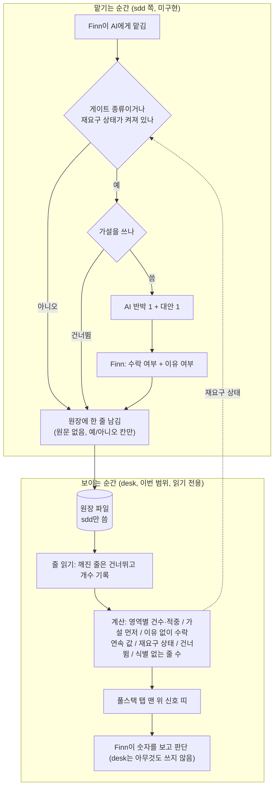

# PRD: desk-hypothesis-gate (초안)

> 설계 입력: 이슈 #1(확정 7건 + 열린 질문 5개). 이 문서는 열린 질문을 Finn이 하나씩 정하면서 「결정」 절을 채우는 초안이다.

## 결정 (열린 질문 → 확정)

| 주제 | 결정 | 결정 주체 | 이유 |
|---|---|---|---|
| 신호를 보일 화면 | 새 메뉴 없이 **풀스택 탭 맨 위에 영역별(FE·BE·infra·도메인) 신호 띠**를 얹는다. 입력 건수·적중(맞음/부분/틀림 3값, "모르겠다"는 뺀다: 적중은 AI가 판단하는 값이라 Finn 2026-11-13) 건수와 판정 전 건수(가설은 있는데 적중 줄이 아직 없음)·연속 건수·건너뜀 건수·작업 식별 없는 줄 수만 보이고 기준값은 박지 않는다(이슈 결정 4, 연속·건너뜀은 2026-11-13 추가) | AI 추천 수용 + Finn 동의 | AI: 풀스택과 같은 영역 축이라 한 화면에서 비교되고, 첫 2~4주는 비포만 쌓여 별도 화면은 빈 채로 남는다. Finn: 이유 미기재 |
| 상환 단계 | **이번 범위에서 뺀다.** 기록이 쌓인 뒤 실제 빈도를 보고 주기·방식을 다시 정한다(`미측정`) | AI 추천 수용 (Finn 선택) | AI: 첫 2~4주는 비포만 쌓여 상환할 기록이 거의 없고 주기를 정할 근거 숫자가 없다. 지금 넣으면 지어낸 주기가 굳는다 |
| 옛 카드 이전 | **레포 `_learn/inbox.md`의 옛 카드는 원장으로 옮기지 않는다.** 원장은 새 입력부터 쌓는다. 옛 카드는 풀스택 탭의 기존 복습 목록으로 계속 읽는다 | AI 추천 수용 (Finn 선택) | AI: 옛 카드에는 적중 칸이 없어 소급하면 기억 기반 값이 비포에 섞이고, 신호 계산에 못 쓰인다 |
| 게이트 위험도 기준 | **종류로 가른다.** 이름 붙은 종류에만 가설 게이트를 건다. 종류 목록은 미정(이슈 결정 3의 예: 설계·계약·삭제) | Finn (스스로 선택, 이유 미기재) | AI 지적: 목록에 없는 종류는 게이트 없이 지나간다 |
| 게이트 종류 목록 | **데이터 모델·스키마 · API 계약 · 에러 처리 방침 · 삭제·덮어쓰기 · 보안·권한·비밀값.** 목록은 코드에 박지 않고 `config.json`으로 받는다(ADR-008 패턴). 외부 발행(push·PR·슬랙)은 뺀다: 하네스가 이미 사람 확인을 받는다 | AI 추천 수용 (Finn: 모르겠다 → "전부 괜찮아, 그대로", 이유 미기재) | AI: 안 걸면 굳는 것·되돌릴 수 없는 것·테스트가 못 잡는 것. 앞 셋은 전역 IDI 대상과 같은 종류이고 새로 늘어나는 건 삭제·보안 둘이다. sdd 0.35.0 게이트와의 겹침은 미확인 |
| 원장 필드 추가(개선 지표 둘) | 원장 한 줄에 **가설 입력(예/아니오) · AI 추천 받음(예/아니오) · 추천 수락(예/아니오) · 내 이유 입력(예/아니오)** 네 칸을 더한다. 값은 예/아니오뿐이고 가설·이유 원문은 원장에 넣지 않는다(이슈 결정 6). desk는 두 비율을 센다: ① 가설 먼저 = 가설 입력 건 / 의미 있는 줄 수(분모는 `gate`·`hyp`·`rec` 중 하나라도 채워진 줄, 2026-11-13 Finn 확정. 같은 날 앞서 "모든 줄"로 정했다가 바꿨다: 원장이 프롬프트마다 한 줄이면 "응"·"계속" 같은 짧은 입력이 분모를 부풀려 값이 의미를 잃는다. 게이트에서 건너뛴 줄은 `gate`가 있어 분모에 남고, 요구에 응했는지는 건너뜀 건수가 맡는다. `gate`는 모델이 쓰는 값이라 모델이 게이트를 놓친 맡김은 분모에서 빠질 수 있다(추정). 값이 낮은 게 정상이라 수준이 아니라 기준 기간 대비 추세로만 읽는다) ② 이유 없이 수락 = (수락 예 + 이유 아니오) / 추천 받음 예(`gate`가 있는 줄만, `gate=null` 줄은 분모·분자에서 뺀다, Finn 2026-11-13: 연속 계산이 `gate=null`을 빼는 것과 기준을 맞춘다). 기준값은 박지 않고 첫 2~4주를 기준으로 쓴다 | Finn (wiki 세션 요청을 확인하고 "필드 추가해줘") | wiki 요청: 수동 표기(decided_by)는 수락이 적게 기록돼 믿기 어렵고, 입력 순간 자동 집계가 낫다. AI 확인: ①의 분모를 원장 줄 수로 잡으려면 "한 줄 = 위임 한 건"이어야 하는데 이는 미확인이고 sdd 작업에서 정한다. 2026-11-13: 줄 단위는 아래 「원장 줄 단위」로 정했다. 칸 목록은 sdd 쪽 세션이 확정했다(그쪽 메시지 기준, desk는 읽기만): 맡김 줄 `ts, repo, task, gate, area(FE|BE|infra|domain|unknown), hyp, rec, acc, why, rebut, skip`, 적중은 별도 추가 줄 `ref(원 줄의 ts), hit(right|partial|wrong), by(model|finn)`(같은 ref는 마지막 줄 유효, 화면 글자는 desk가 right=맞음·partial=부분·wrong=틀림으로 매핑). 난이도 칸은 없다(Finn). 파일은 전역 하나, 설정 키 `hypothesis_ledger`가 가리킨다. 두 번째 비율의 분자는 "수락 예 AND 이유 아니오"로 읽는다(AI 해석, 확인 필요) |
| 목적 (2026-11-13) | 가설은 사후 측정이 아니라 **맡기는 시점에 이해 못 한 상태가 다음 결정으로 이어지는 걸 막는 사전 방지**다. 설명·리뷰에서 막히는 순간은 사후에 알게 되므로 이 기능이 재지 않는다 | Finn | Finn: "알게 되는 때가 모두 밖은 어쩔 수 없고, 그 순간들에서 이해하지 못하는 상태가 이어지지 않도록 사전에 방지하는 게 가설". AI가 사후 '막힘 기록'을 제안했다가 목적과 어긋나 철회했다 |
| 원장 줄 단위 | **모든 맡김에 줄을 자동으로 남긴다**(가설 칸은 비어도 됨). 작업 식별이 없는 작은 요청도 줄은 남기되 연속에는 넣지도 끊지도 않는다(AI 해석이었으나 2026-11-13 Finn이 "이어 간다"로 확정). 식별 없는 줄 수는 띠에 개수로 보인다(AI 제안, 연속이 실제보다 낮을 수 있음을 알리려고, 반려 가능) | AI 제안, Finn이 명시로 고르지 않음(다음 결정들과 이 문서 반영 승인으로 갈음, 반려 가능). 작은 요청은 식별 없어도 됨: Finn | AI: 연속을 세려면 게이트 종류가 아닌 맡김의 줄도 있어야 한다. sdd는 이 줄을 쓰는 코드가 없다(harness 확인 2026-11-13, 미구현) |
| 가설 요구 시점 | 게이트 종류에서 요구하고, **연속 기준에 닿은 뒤 맡김부터도** 요구한다. 모든 맡김에 쓰게 하지 않는다 | Finn | Finn: 모든 맡김에 쓰기엔 귀찮아서 안 쓰는 게 더 많아질 것 같다 |
| 연속 정의·범위 | **같은 작업 안에서**(레포마다 task 이름이 겹칠 수 있어 `(repo, task)` 쌍이 한 작업, sdd 쪽 확정 2026-11-13) '이유 없이 수락'이 이어지는 것. 작업이 바뀌거나 이유를 쓴 줄이 나오면 0(이유 줄이 끊는 것은 2026-11-13 추가). 기준 횟수는 박지 않고 기준 기간(2~4주) 뒤에 Finn이 정한다 | Finn(범위 선택, 이유 미기재) / 이유 줄이 끊는다: AI 추천 수용 | AI 반박: 작업이 짧으면 기준에 닿기 전에 리셋돼 작은 작업이 이어지는 흐름은 못 잡을 수 있다. `미측정`: 원장이 쌓인 뒤 작업별 줄 수 집계 |
| 리셋 · 건너뜀 | 연속 값과 재요구 상태를 **따로 둔다**(2026-11-13). 연속 값은 이유를 쓴 줄·작업 바뀜에 0. **가설 재요구는 연속이 기준에 닿으면 켜지고, 가설 + AI 반박을 받아야 꺼진다**(연속이 0이어도 유지). 켜진 동안 맡길 때마다 가설을 다시 요구하되 **막지 않는다**: 건너뜀은 기록하고 desk에 연속 건수로 보인다 | Finn(둘 다 선택, 이유 미기재) / 값·상태 분리: AI 추천 수용(2026-11-13) | AI 지적: 리셋 비용이 가장 지친 때 가장 커서 건너뛸 가능성이 높다. 꺼짐 조건은 sdd 쪽 세션이 정했다(2026-11-13, 그쪽 메시지 기준): 켜진 뒤 같은 `(repo, task)` 안에서 `hyp=true` 줄과 `rebut=true` 줄이 순서 무관으로 모두 나오면 둘째 줄에서 꺼진다. 같은 줄일 필요 없음(AI 권장안을 Finn이 수락했다고 그쪽이 적음, 이쪽 미확인). `task=null` 줄은 모으기에 넣지도 끊지도 않고, task=null 맡김만으로는 못 끈다. 켜짐 기준 횟수는 설정으로 받는다. 재요구 동작은 미구현(harness 확인) |
| desk 역할 | **읽기 전용.** 원장을 읽어 연속 건수·건너뜀·기존 건수를 보일 뿐 쓰지 않는다. desk 입력 허용(2026-11-12)은 이번 범위에서 되돌렸다 | Finn(번복, 이유 미기재) | AI 지적(번복 전): desk의 사후 가설은 AI 반박이 없어 리셋 조건과 충돌하고 '가설 먼저' 비율을 부풀린다 |

한계(AI 지적, Finn 미반박): 탭은 일이 끝난 뒤 여는 곳이라 위임하는 순간에는 못 돕는다. 위임 순간의 게이트는 sdd가 맡는다(이슈 결정 5).

## 하지 않을 것

- desk가 원장이나 입력 파일에 쓰기 (읽기 전용)
- 연속·건수에 기준값을 코드에 박기 (Finn이 기준 기간 뒤에 정함)
- 연속 기준에 닿았을 때 가설을 못 쓰면 맡김을 막기 (건너뜀은 기록만)
- 사후 막힘 기록, 상환 단계, 옛 카드 이전
- 가설·이유 원문, 코드를 원장에 적기

## 사용자 흐름 (초안, 2026-11-13)

위쪽 묶음(맡기는 순간)은 sdd 쪽이고 전부 **미구현**(harness 확인 2026-11-13)이다. 아래쪽 묶음(원장을 읽어 보이기)이 이번 desk 범위다. 둘은 원장 파일 한 곳에서만 만난다.

점선은 desk가 상태를 sdd에 보내는 게 아니다. 같은 원장 줄을 sdd도 읽어서 재요구 상태를 스스로 계산한다는 뜻이고, sdd 쪽 세션이 줄 순서만으로 계산된다고 답했다(2026-11-13, 그쪽 설계 기준이라 구현 확인 전). 원장을 잘라내거나 회전하면 상태가 사라지므로 전체 보존이 전제다.

## 수용 조건 (초안, 2026-11-13 — Finn 확인 전)

모두 **가짜 원장**으로 확인한다. 칸 이름은 초안이라(원장 줄 형식은 sdd 작업에서 확정) 줄 형식이 정해지면 이름만 맞춘다. 기준 횟수는 테스트에서만 가짜 값(2)을 쓴다.

| 이름 | 조건 (입력 → 기대) |
|---|---|
| 영역 건수·적중 | 영역별로 줄을 섞은 원장(맡김 줄 + 적중 줄) → 응답의 영역별 입력 건수와 적중 세 값(맞음/부분/틀림) 건수가 줄에서 직접 센 값과 같다. 적중은 `ref`로 원 줄을 찾아 그 줄의 `area`에 센다. 같은 `ref`가 여러 줄이면 마지막 줄만 센다. 가설 입력 예인데 적중 줄이 없는 줄은 "판정 전" 건수로 따로 센다 |
| 가설 먼저 | 의미 있는 줄(`gate`·`hyp`·`rec` 중 하나라도 채움) 10줄 중 가설 입력 예 3줄 → 0.3. 세 칸이 다 빈 줄("응"·"계속")을 5줄 섞어도 0.3이다. 게이트에서 건너뛴 줄(`gate`만 채움)은 분모에 든다. 의미 있는 줄이 0이면 0%가 아니라 "값 없음" |
| 이유 없이 수락 | `gate`가 있고 추천 받음 예인 4줄 중 (수락 예 AND 이유 아니오) 1줄 → 0.25. `gate=null`이고 추천 받음·수락 예인 줄을 섞어도 값이 같다. 추천 받음(`gate` 있음)이 0이면 "값 없음" |
| 연속 값 | 같은 작업 식별의 줄에서 이유 없이 수락 3번 → 3. 이유를 쓴 줄 → 0. 작업 식별이 바뀌면 → 0. 식별이 빈 줄은 세지도 끊지도 않는다 |
| 재요구 상태 | 기준 2에서 이유 없이 수락 2번 → 켜짐. 이유만 쓴 줄이 와도 켜진 채 유지(연속 값만 0). 같은 `(repo, task)`에서 가설 입력 예 줄과 반박 예 줄이 순서 무관으로 둘 다 나오면 둘째 줄에서 꺼짐. 켜진 뒤 task가 바뀌면 모은 것을 버린다. task 식별 없는 줄은 모으기에 넣지도 끊지도 않는다 |
| 건너뜀 건수 | 건너뜀 예 줄 수와 같다. 연속·건너뜀·재요구는 작업 식별 단위로 센다 |
| 식별 없는 줄 | 같은 작업 a의 줄 사이에 식별이 빈 줄이 끼어도 a의 연속은 이어진다(예: a 수락, a 수락, 빈 줄, a 수락 → 3). 식별 없는 줄 수가 띠에 개수로 보인다 |
| 없음·깨짐 표시 | 설정 키 비어 있음 / 경로 없음 / 파일 없음 / 형식 확인 필요 → 각각 이유가 적힌 행이 보인다. 기록 0건이어도 띠가 보이고, 위 이유 행과 구별된다 |
| 깨진 줄 | 깨진 줄 1개를 섞은 원장 → 나머지로 계산하고, 건너뛴 개수 1과 줄 번호·이유가 보인다 |
| 읽기 전용 | 서버를 띄워 신호를 읽은 전후로 원장 파일이 바이트까지 같다. 원장·입력 쓰기 요청은 받지 않는다 |
| 원문 없음 | 가설·이유 원문 칸이 섞인 줄이 있어도 응답에 원문이 실리지 않는다 |
| 실패 격리 | 신호 응답이 실패해도 풀스택 탭의 기존 카드 목록은 그대로 보인다 |
| 화면 연결 | 가짜 원장으로 서버를 띄워 브라우저에서 한 번 본다: 띠의 값이 응답의 값과 같다(2026-11-12 회색 배지 사고 재발 방지) |

## 성공 지표

| 지표 | Before | After |
|---|---|---|
| 가설 먼저 비율 (가설 입력 줄 / 의미 있는 줄) | `미측정: 원장이 쌓인 뒤 기준 기간(2~4주)의 desk 신호 띠 값을 Before로 기록` | 8주 뒤 같은 값(8주는 ADR의 원장 경로 이유에 적힌 비교 시점)과 비교. 수준이 아니라 기준 기간 대비 추세로 읽는다 |
| 이유 없이 수락 비율 | 위와 같은 방법·기한 | 위와 같음. 분자 읽기는 AI 해석이라 확인 필요 |

Before는 지금 존재하지 않는 값이다(원장이 아직 없다). 결정 주체: Finn(측정 방법 확인, 2026-11-13). 켜진 날짜를 띠에 같이 보일지는 「아직 열린 것」에 있다.

## 아직 열린 것

- [ ] sdd 쪽 구현은 아직 없다(harness 확인 2026-11-13: 맡김 한 건의 정의·게이트 종류 판정 주체·연속 건수 저장). 설계안은 sdd 쪽이 쓰는 중이다. desk는 기다리지 않고 가짜 원장으로 만든다(막지 않음)
- [x] 원장 파일·칸 이름·값: sdd 쪽 세션이 확정(2026-11-13, 위 「원장 필드 추가」 행). 난이도 칸은 뺐다(Finn)
- [x] `hyp·rec·acc·why·rebut`은 모델이 프롬프트 시점에 같은 판정 호출에서 선언한다(2026-11-13, Finn 결정이라고 sdd 쪽 메시지가 적음, 이유 미기재). 정확도는 `미측정`이고, 첫 2주 안에 Finn이 샘플 20건을 대조하자는 것은 sdd 쪽 제안이다(Finn 수락 전). 두 비율은 이 정확도가 확인되기 전까지 참고값이다
- [ ] sdd 쪽이 알린 한계(그쪽 메시지 기준, desk는 읽기만 하므로 값 해석에 반영): 훅은 가설 요구를 강제하지 못해 모델이 무시하면 건너뜀으로만 남는다 / 모델이 판정 선언을 빼먹으면 그 프롬프트 줄이 원장에서 빠진다(줄 쓰기를 강제할 수 있는지는 sdd 구현 첫 단계에서 확인) / task 식별 없는 맡김만으로는 재요구 상태가 꺼지지 않는다 / `area`도 모델 선언이라 정확도 `미측정`. 설계안은 sdd 쪽 문서 참고(파일 경로는 적지 않는다)
- [x] 이유 없이 수락 비율에서 `gate=null` 줄은 뺀다(2026-11-13 Finn, 이유 미기재). 형태상 `gate=null` 줄도 rec·acc가 채워질 수 있다(sdd 쪽 확인)
- [x] 연속이 끊기는 조건: 이유를 쓴 줄이 연속 값을 끊고, 재요구 상태는 가설 + 반박으로만 꺼진다(2026-11-13 Finn, AI 추천 수용). 재요구 상태가 원장 줄만으로 계산되는지는 가짜 원장으로 구현 때 확인(추정)
- [ ] 연속 기준 횟수: Finn이 기준 기간(2~4주) 뒤에 정함
- [ ] 게이트가 켜진 날짜를 신호 띠에 같이 보일지: 켜진 날 전후로 '가설 먼저' 값이 뛰어 추세 해석에 필요. 기록 방법 `미측정`(구현 때 결정)
- [ ] Readiness 빈칸: 수용 조건은 초안 작성(위 절, Finn 확인 전). 실패 경로(작업 식별이 일부만 있는 경우)는 정함: 식별 없는 줄은 이어 가고 개수를 보인다(2026-11-13 Finn). 사용자 흐름 차트는 초안을 그림(Finn 확인 전). 성공 지표 Before는 `미측정: 방법/기한`으로 채움(위 「성공 지표」 절). 재요구 꺼짐 조건과 차트 점선 가정은 sdd 쪽 확정으로 닫았다(2026-11-13). 칸 채우는 관찰 방법도 닫았다(위, 2026-11-13). 남은 ⚠️ 없음. 성공 지표의 Before 값은 `미측정: 방법/기한`으로 둔다
- [ ] 이슈 #1 본문의 "desk도 입력을 받는다(2026-11-12 변경)" 정정 (Finn 확인 뒤)
