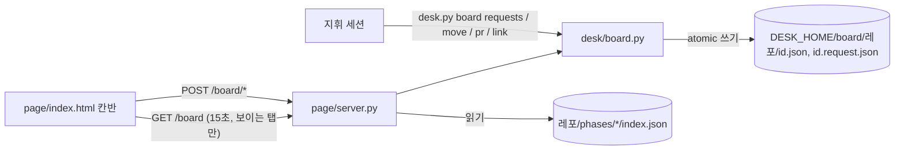

# ARCHITECTURE: desk-kanban (초안)

> 결정 근거는 [PRD.md](PRD.md)의 「결정」 절. 현재 코드의 의존 방향(`scripts/` · `hooks/` · `page/` → `desk/`, 셋은 서로 import하지 않음)을 그대로 따른다. 훅은 건드리지 않는다(토큰 0).

## 키워드

| 말 | 뜻 |
|---|---|
| 카드 | `<DESK_HOME>/board/<레포>/<id>.json` 한 장. 열·제목·메모·날짜·task 이름을 가진다 |
| 시작 요청 | `<DESK_HOME>/board/<레포>/<id>.request.json`. desk가 쓰고 지휘 세션이 읽는다 (`/pick`의 `<id>.pick.json`과 같은 방식) |
| 배지(⏳요청됨) | 저장하지 않는다. 「열 = 예정 이고 요청 파일이 있다」로 화면용 응답에서 계산한다 |
| 레포 이름 | `config.json`의 `repos` 경로의 폴더 이름(`Path(root).name`). 이 목록 밖 이름은 거절한다 |
| 레퍼런스 링크 | `<DESK_HOME>/board/<레포>/<id>.refs.json`. 카드마다 이름 + URL 최대 5개. 서버만 쓴다(`desk.py`는 안 건드린다). 카드 파일과 따로 둔 이유는 아래 「상태 규약」 |

## 개요

desk는 카드와 요청 파일을 쓰고 읽을 뿐이다. 세션 생성·열 이동·merge 확인은 지휘 세션이 `scripts/desk.py`로 한다. 진행도·세부 요약은 이미 읽는 `phases/*/index.json`에서 온다(새로 여는 파일 종류 없음).

## 계층 배치와 데이터 흐름

| 위치 | 하는 일 |
|---|---|
| `desk/board.py` (신규) | 순수 함수: 카드 검증, 열 전이 규칙, 경과 일수, 후보 표식, 화면용 응답 만들기. 파일 읽고 쓰는 얇은 함수도 여기(`desk/routine.py`와 같은 선례). 쓰기는 모두 `desk/atomic.py` |
| `desk/paths.py` | `board_dir(repo)` 하나 추가 |
| `page/server.py` | 엔드포인트 얇은 핸들러. 토큰·Origin·Host는 `_check_post_guard` 재사용 |
| `scripts/desk.py` | 지휘 세션용 서브커맨드 `board requests` · `board move` · `board pr` · `board link` |
| `page/index.html` | 새 메뉴 「칸반」: 열 3개, 카드, 배지, PR 대기 표시, 후보 표식, 우측 상세 패널, 보관 보기 |

## 엔드포인트

| 엔드포인트 | 하는 일 |
|---|---|
| `GET /board` (`?archived=1&repo=&from=&to=&sort=&q=`) | 레포 전체(또는 `repo` 하나) 카드를 열 3개로 묶어 낸다. `from`·`to`(날짜, 한쪽만 가능)는 서버가 열별 기준일(예정 만든 날 · 진행 시작일 · 완료 merge일)로 걸러 내고, 열마다 필터 적용 전 전체 건수를 같이 준다(화면이 자르지 않는다). `sort`(열별 최신순·오래된순, 기준일은 예정 만든 날 · 진행 시작일 · 완료 merge일, 기본은 예정·진행 오래된순 · 완료 최신순, 쿼리 모양은 열마다 하나씩 `sort_planned`·`sort_doing`·`sort_done`, 값은 `new`·`old`, 안 주면 기본값)도 서버가 처리한다. `q`(카드 제목만 부분 일치·대소문자 무시, 비거나 공백뿐이면 필터 없음, 다른 필터와 AND)도 서버가 걸러 열마다 걸린 수와 필터 전 전체 건수를 같이 준다. 모르는 `repo`·잘못된 날짜·`from`>`to`·모르는 `sort`는 400(「진행」은 PR 대기 표시 카드가 맨 위, 정렬과 무관하게 서버가 정렬). 카드마다 배지·PR 대기 표시·경과 일수·진행도(완료 step/전체)·후보 표식·연결 상태(설계 중/연결 끊김)를 서버가 계산해 내려 준다. 화면은 그리기만 한다 |
| `GET /board/card?repo=&id=` | 카드 상세: 메모·날짜 전부 + 레퍼런스 링크(`refs`: id·이름·URL) + 연결된 task의 step 목록과 summary. 카드를 눌렀을 때만 부른다(폴링 가볍게) |
| `POST /board/add` | 레포·제목·메모, 선택으로 링크(최대 5개). 제목 빔·모르는 레포 거절. 같은 레포에 같은 제목의 예정 카드가 있으면 409. 링크 검증(개수·이름·URL)을 먼저 하고 하나라도 틀리면 400, 카드도 만들지 않는다(검증 먼저, 쓰기 나중) |
| `POST /board/delete` | 예정 열만. 아니면 409 |
| `POST /board/archive` · `POST /board/revive` | 예정 밖 열은 보관, 되살리기 |
| `POST /board/start` | 예정 카드만. 요청 파일이 이미 있으면 409 (요청 파일을 한 번만 쓴다) |
| `POST /board/cancel` | 예정 카드이고 요청 파일이 있을 때만 `<id>.request.json`을 지운다. 이미 예정을 떠났으면 409. 지휘 세션이 이미 읽었으면 못 막는다(한계) |
| `POST /board/ref/add` · `/ref/update` · `/ref/delete` | 카드의 `<id>.refs.json`을 고친다. 링크 id는 서버가 만든다. 검증은 `add`와 같다: 이름 1~40자, URL은 `http(s)://`로 시작하고 2000자 이하, 카드당 최대 5개(6번째 추가는 409). 없는 카드·링크는 404. 모든 열의 카드(보관 포함)에 허용한다. `desk.py board link`는 task 기록 명령이라 이름이 겹치지 않게 `ref`를 쓴다 |

## 상태 규약

- 카드 필드: `title` · `note` · `column`(`planned`·`doing`·`done`) · `task`(없으면 null) · `created_at` · `doing_at` · `pr_at`(PR 대기 표시, `doing`에서만 값이 생김) · `done_at` · `archived_at`. 시각은 epoch(float), 지금 코드와 같다. PR 대기는 열이 아니라 `pr_at`이 있는 `doing` 카드다.
- **시작 요청 시각은 카드에 쓰지 않고 요청 파일의 `at`을 쓴다.** 이유: 서버(`start`)와 `desk.py`(`move`)가 같은 카드 파일을 읽고 고쳐 쓰면 나중에 쓴 쪽이 앞의 변경을 지운다. 서버가 쓰는 시작 요청을 별도 파일로 빼면 이 경로의 충돌이 사라진다. (PRD 수용 조건 「작업 시작」 문구를 이에 맞춰 고침)
- **레퍼런스 링크도 카드 파일에 쓰지 않고 `<id>.refs.json`(`{"refs":[{"id","name","url"}]}`)에 쓴다.** 이유: 서버(`/board/ref/*`)와 `desk.py`(`move`)가 같은 카드 파일을 고쳐 쓰면 나중에 쓴 쪽이 앞의 변경을 지운다(시작 요청 파일과 같은 이유). 카드를 삭제하면 카드 파일·요청 파일·링크 파일을 함께 지운다. 파일이 깨졌으면 그 카드의 링크만 빈 목록으로 보이고 응답에 `broken`으로 센다. 깨진 링크 파일에는 추가·수정·삭제를 거절한다(409 `refs broken`, 파일은 그대로)
- 남는 충돌: 서버의 보관/되살리기와 `desk.py`의 이동이 같은 순간에 겹치는 경우. 한 사람(Finn)과 한 지휘 세션뿐이라 드물다고 보고 잠그지 않는다. `미측정: 실제로 겹치는 빈도` (나중에 카드가 어긋나면 이 줄부터 본다)
- 열 이동은 `planned → doing → done` 순방향만 허용한다. 거꾸로·건너뛰기는 `desk.py board move`가 거절한다 (PRD에 없던 AI 판단, 반려 가능). 이유: 지휘 세션이 잘못 부른 한 번이 날짜 기록을 망가뜨리는 걸 막는다
- PR 대기 표시는 `desk.py board pr <레포> <id>`가 `doing` 카드에 `pr_at`을 한 번만 적는다. `doing`이 아니거나 이미 있으면 거절한다. 되돌리는 명령은 없다(순방향 규칙과 같다)
- 경과 일수: 「진행」은 요청 파일 `at`부터, PR 대기 표시가 있으면 `pr_at`부터. 오늘 날짜는 서버 기준(`_today()`)
- 정렬: 「진행」 열은 `pr_at`이 있는 카드가 항상 위, 그 안과 나머지는 열별 정렬 토글(`sort`)을 따른다(서버가 정렬해 내려 준다)
- 링크 삭제의 5초 되돌리기는 카드 삭제와 같다: 화면이 5초 뒤에 `POST /board/ref/delete`를 보내고, 되돌리면 보내지 않는다(서버에 임시 상태 없음). 새로고침하거나 탭을 닫으면 대기 중 삭제는 보내지 않는다(한계)
- 링크 편집 중 `GET /board/card` 갱신은 편집 중인 한 줄을 덮어쓰지 않는다. 이건 화면 규칙이라 서버 변경은 없다
- 같은 제목 거절(409)은 서버가 제출 뒤에만 판정한다. 입력 중 중복 검사 엔드포인트는 만들지 않는다
- 후보 표식: 열이 `doing`이고 `pr_at`이 없으며 연결된 phases 전 step이 `completed`일 때만. step이 0개면 표식 없음
- 연결 상태: `doing`이고 `task` 없음 → 「설계 중」, `task`는 있는데 `phases/{task}/index.json`이 없음 → 「연결 끊김」
- 읽기 실패: 카드 파일이 깨졌으면 그 카드만 건너뛰고 응답에 `broken` 개수를 준다(다른 카드는 보인다). phases를 못 읽으면 진행도만 비운다

## 경계

- desk는 프로세스를 실행하지 않는다(서브프로세스 호출 없음). 쓰는 곳은 `board/<레포>/` 아래 카드·요청 파일뿐 (ADR-009 읽기 허용 목록 원칙과 ADR-011 「사람의 행동은 서버가 파일로 쓴다」를 따른다)
- 카드 id는 서버가 만든다. 입력 id·레포는 `valid_repo_name`으로 거른다(경로 탈출 방지, `/pick`과 같은 검사)
- `desk.py`는 카드 내용을 검사하지 않는다. 사람 이름·원문 금지는 화면 안내 문구와 쓰는 사람의 규칙이다
- 링크 URL은 desk가 열어 보거나 가져오지 않는다(서브프로세스·HTTP 요청 없음). 화면은 `textContent`와 `rel="noopener noreferrer"` 새 탭 링크로만 그린다. 검증이 `http(s)`만 받아 `javascript:`가 `href`에 들어가지 않는다
- `/nav-counts`는 건드리지 않는다. `tests/test_desk_redesign_integration.py:36`의 키 집합 단언도 그대로다

## 테스트 전략

- 순수 함수(`desk/board.py`): 열 전이 표, 경과 일수, 후보 표식, 연결 상태를 단위 테스트
- 임시 `DESK_HOME`으로 파일 쓰기: 카드 추가·삭제·보관·요청 파일 1개·두 번째 요청 거절·이동 후 파일이 반쯤 쓰인 상태로 안 읽힘
- 서버: 가짜 `DESK_HOME`·`DESK_CONFIG` 서버로 엔드포인트와 POST 가드(토큰 없으면 403)
- 링크·검색: 6번째 링크 거절 · `javascript:`·로컬 경로 URL 거절 · 카드 추가 중 링크 하나가 틀리면 카드 파일도 안 생김 · 삭제하면 링크 파일도 사라짐 · `q`가 제목에만 걸리고 `repo`·기간과 AND이며 열마다 걸린 수·전체 수가 다름
- 화면 연결: 가짜 카드로 서버를 띄워 브라우저에서 한 번 본다 (non-obvious-patterns 「서버 · 화면」)
- 응답 키를 더하는 step이면 그 응답을 비교하는 기존 테스트를 grep으로 찾아 RED 커밋에 넣는다 (non-obvious-patterns 「sdd · 응답 키 추가」). 이번엔 새 엔드포인트라 기존 응답은 바뀌지 않는다

## 아직 열린 것

- [ ] `GET /board`가 레포마다 `phases`를 읽는 비용: 레포 수·카드 수 `미측정`. 첫 구현은 레포당 `list_phase_indexes` 한 번
- [x] `sort` 쿼리 모양: 열마다 파라미터 3개(PLAN, AI 추천 수용, ADR 「sort 쿼리 모양」)
- [ ] 카드 id 형식(시각 기반 등)은 구현 때 정한다
