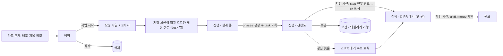

# PRD: desk-kanban (초안)

> 설계 입력: 2026-11-14 채팅의 칸반 요청과 `why` 질문 결과. 이 문서는 질문을 하나씩 정하며 「결정」 절을 채운 초안이다. Finn 확인 전.

## 날것

desk에 칸반보드 메뉴를 넣고 싶다. 작업 진행을 한눈에 보고, 작업 예정인 것을 관리하고 싶다. 할 일 카드는 화면에서 추가·삭제하고 레포를 지정한다. 「작업 시작」을 누르면 지휘 세션에 넘기고, 지휘 세션이 작업 세션을 만들어 시작한다. 카드를 누르면 관련 세부 요약을 본다. 트랙 화면은 지금 도는 작업 세션을 확인하는 용도라 칸반과 별개다.

## 무엇을 · 왜

**무엇을**: 새 메뉴 「칸반」. 카드를 열 3개(예정 · 진행 · 완료)로 보여주고(PR 대기는 「진행」 카드의 표시), 카드에서 작업 시작 요청을 지휘 세션에 넘긴다.

**왜 (진짜 문제 · 목표 · 최적 행동 · 한 줄 정의)**: 지휘 세션 하나가 여러 작업 세션에 일을 나눠 주는 흐름에서, 할 일과 진행이 세션들에 흩어져 한눈에 안 보인다. 그래서 예정부터 merge까지 한 화면에서 보고 시작까지 넘기려고, desk에 칸반(카드 파일 + 시작 요청 파일 + 지휘 세션 갱신)을 만든다. `[가정]` WHY는 Finn의 말을 정리한 것이다.

**전제**: 지휘 세션은 항상 켜 두고 쓴다(Finn 2026-11-14). 이 워크플로우를 돕는 것이 desk의 목적이다.

## 참고 자료

없음(Finn 답 없음, 없음으로 적음). 이 레포의 기존 결정: ADR-009(desk는 허용된 파일만 읽고 다른 프로세스를 실행하지 않는다), ADR-011(사람의 행동은 서버가 표식 파일로 쓴다), `/pick`이 인박스에 `<id>.pick.json`을 쓰는 방식(시작 요청 파일이 따라갈 선례).

## 결정

| 주제 | 결정 | 결정 주체 | 이유 · 버린 방법 |
|---|---|---|---|
| 트랙과의 관계 | 트랙은 그대로 두고 칸반은 **별도 새 메뉴**다 | Finn | Finn: 트랙은 현재 도는 작업 세션을 확인하는 용도라 칸반과 별개 |
| 작업 시작 방식 | desk는 **시작 요청 파일만 쓴다.** 지휘 세션이 읽어 오르카로 작업 세션을 만든다. desk는 프로세스를 실행하지 않는다 | Finn(이유 미기재) | AI가 채움: 화면 버튼에서 명령 실행 경로가 안 생겨 ADR-009가 유지되고, 세션 생성이 신뢰하는 지휘 세션 한 곳에 모인다. 버린 방법: desk가 오르카를 직접 호출 |
| 카드 저장 | desk 홈 폴더의 파일 `board/<레포>/<id>.json`. 커밋하지 않는다. GitHub 이슈는 쓰지 않는다 | Finn | Finn: 커밋될 필요가 없고, 이슈는 진행 중인 작업이 섞여 따로 관리해야 한다. desk 단독으로 관리하고 싶다 |
| 열 이동 | **지휘 세션이 카드를 옮긴다.** desk 화면에서 사람이 열을 옮기지 않는다 | Finn | Finn: 지휘 세션이 작업이 완료됐는지 파악할 수 있다 |
| 완료의 뜻 | **PR merge 시점**이다. merge 확인은 지휘 세션이 `gh`로 한다. desk는 merge를 직접 못 본다 | Finn(이유 미기재) | AI가 채움: step이 끝나도 리뷰·수정이 남을 수 있어 그 사이를 완료로 세지 않는다. 한계: 지휘 세션이 안 옮기면 merge돼도 카드는 안 움직인다 |
| 열 구성 | **열 3개: 예정 · 진행 · 완료.** 「PR 대기」는 열이 아니라 「진행」 카드의 표시(🔶 PR 대기)이고, PR 대기 카드는 「진행」 열 맨 위로 정렬한다. 「요청됨」도 열이 아니라 카드 배지(⏳요청됨)다. 지휘 세션이 세션을 만들어 「진행」으로 옮기면 배지가 사라진다 | Finn(2026-11-14 "열 3개로 PR대기는 표시로": PR 대기를 표시로 바꾸자는 제안과 수락 / 요청됨 열 빼기: Finn 제안) / 배지로 남기기 · 맨 위 정렬: AI 기본값 | AI: 열이 줄어 지휘 세션이 옮길 지점이 하나(진행→완료)로 준다. "내 손이 필요한 곳"(리뷰 판정·merge)은 맨 위 정렬과 🔶로 보인다. 반박: 표시는 열보다 눈에 덜 띈다. 진행 카드가 많으면 🔶가 묻힐 수 있다(맨 위 정렬로 막는다). 배지는 버튼을 눌렀는지 알 수 있게 남긴다 |
| 후보 표식 | 카드가 「진행」에 있고 아직 PR 대기 표시가 없으며 연결된 `phases`의 step이 **전부 completed**이면 카드에 「⚠ step 전부 끝남 · PR 대기 후보」를 **표시만** 한다. desk는 카드를 스스로 옮기지 않는다. 「완료 후보」는 만들지 않는다 | Finn(이유 미기재) | AI: 지휘 세션 갱신이 늦어도 눈으로 알아챈다. 반박: 표식은 추측이다. 이미 손으로 merge됐어도 desk는 구분 못 한다. 한계: 카드마다 `phases` 인덱스를 읽어 폴링 읽기량이 는다 |
| 카드 ↔ phases 연결 | **지휘 세션이 `phases/{task}/`가 생긴 뒤 task 이름을 카드에 기록한다.** 그전의 「진행」 카드는 「설계 중」으로 보인다. 기록된 이름의 `phases`가 없으면 「연결 끊김」으로 보인다 | Finn("연결된 시점도 적절하다", AI도 같은 의견) / 「설계 중」·「연결 끊김」 문구: AI 기본값 | AI: 존재하는 이름만 적혀 오타로 끊기지 않고 입력란이 늘지 않는다. 감수: DESIGN이 끝날 때까지 진행도·표식이 없다. 버린 방법: Finn이 입력 / desk가 제목으로 추정 |
| 필터 | 헤더에 **레포 검색 셀렉트**와 **기간 From~To**를 둔다(「보관 보기」 왼쪽). 기간 기준일은 열마다 다르다(예정 만든 날 · 진행 시작일 · 완료 merge일). 한쪽만 비워도 된다. 선택은 새로고침하면 초기화. 레포 필터가 있는 다른 화면도 같은 검색 셀렉트로 바꾼다 | Finn(2026-11-14 채팅 「레포필터는 셀렉트…날짜필터도 추가」 · 「기간은 from, to로」 · 「응 B로」) / 한쪽 비움·초기화·즉시 적용: AI 기본값 | AI: 카드가 쌓일수록 레포·기간으로 좁혀야 묵은 카드를 찾는다. 반박: 열마다 기준일이 달라 같은 기간이 열마다 다른 뜻이다(화면에 안내 한 줄) |
| 메뉴 배지 | **사이드 메뉴 「칸반」 옆에 숫자를 달지 않는다.** `/nav-counts`는 안 건드린다 | Finn(이유 미기재) | AI: 키가 안 늘어 기존 단언을 안 고치고 첫 버전이 줄어든다. 반박: 화면을 열어야만 PR 대기 카드가 묵는 걸 안다 |
| 날짜 · 경과 · 보관 | 카드는 **생성 · 시작 요청 · 진행 시작 · PR 대기 표시 · 완료 · 보관 시각**을 각각 기록한다. 「진행」 카드는 **작업 시작을 누른 날부터** 며칠 지났는지 보인다. **예정 열의 카드만 삭제할 수 있고**, 그 밖의 열은 **보관**(숨김)이다. 보관한 카드는 기본 화면에서 숨기고 「보관 보기」에서 보이며 되살릴 수 있다 | Finn(보관·날짜·경과 일수는 Finn 제안, 시작점: "작업 시작 누른 날부터", 이유는 지휘 세션이 항상 켜져 있어서) / PR 대기의 경과 일수 · 보관 보기 · 되살리기: AI 기본값 | AI: 묵는 카드를 숫자로 찾는다. 보관한 카드는 이력으로 남는다. 반박: 시작 요청 시각과 진행 시작 시각이 어긋나면(지휘 세션이 늦게 옮김) 그 간격이 경과 일수에 들어간다 |
| 카드 백업 | **하지 않는다.** 카드는 폴더째 복사하면 되는 JSON 파일이다. 카드 장수는 `미측정`이고 쌓이면 그때 잰다 | AI 기본값(Finn 확인 필요) | AI: 아직 필요한 근거 숫자가 없다 |
| 시작 버튼 중복 | 「요청됨」 배지가 있는 동안 「작업 시작」 버튼은 **비활성**이다 | AI 기본값(Finn 확인 필요) | AI: 눌러도 요청 파일이 중복되지 않게 한다 |
| 같은 제목 | **같은 레포의 예정 카드끼리** 제목이 겹치면 추가를 거절한다(409, 입력은 그대로). 진행·완료·보관 카드와의 겹침, 다른 레포와의 겹침은 막지 않는다 | Finn(2026-11-14 채팅 「같은레포끼리는 겹치지않도록하면됨」, 이유 미기재) / 「예정 카드끼리만」으로 좁힌 해석: AI(반려 가능) | AI: 같은 일을 두 번 쌓는 실수를 막는다. 진행·완료와의 겹침을 허용해 같은 일을 다시 할 때 제목을 바꾸지 않아도 된다 |

## 범위 경계

- **이 레포**: 칸반 화면, 카드 추가·삭제·보관·되살리기 엔드포인트, 시작 요청 파일 쓰기, `scripts/desk.py`의 카드 이동·task 기록 명령, 카드별 세부 요약 읽기, 후보 표식 계산.
- **이 레포 밖(지휘 세션 쪽)**: 요청 파일을 읽고 오르카로 세션을 만드는 일, 열 이동 호출, merge 확인(`gh`). `[확인 필요]` 오르카가 세션을 어떻게 만드는지는 desk가 몰라도 된다(desk는 요청 파일만 쓴다).

## 하지 않을 것

- desk가 프로세스를 실행하거나 오르카를 호출하기 (ADR-009)
- desk가 카드를 스스로 옮기기 (열은 지휘 세션이 옮긴다)
- 화면에서 드래그로 열 이동 (AI 판단, 반려 가능)
- 「완료 후보」 표식 (desk는 merge를 못 본다)
- 사이드 메뉴 숫자 배지, `/nav-counts` 키 추가
- 카드 백업
- 지휘 세션이 꺼진 날을 위한 특별 처리 (요청됨 배지가 남는 것으로만 보인다)
- GitHub 이슈 연동, 카드 커밋
- 카드 메모에 사람 이름·vault 원문·세션 대화 원문 적기 (화면에 안내 문구, 기계 검사는 안 함)

## 사용자 흐름

진입: 사이드 메뉴 「칸반」. 동선: 카드 추가 → 작업 시작 → (지휘 세션이 처리) → 진행 → (PR 대기 표시) → 완료. 개인화: 해당 없음(카드와 날짜가 곧 이력이다).

## 수용 조건

모두 **가짜 `DESK_HOME`·가짜 레포(`example.com` 데이터)**로 확인한다. 칸 이름은 초안이라 ARCHITECTURE에서 확정되면 이름만 맞춘다.

| 이름 | 조건 (입력 → 기대) |
|---|---|
| 카드 추가 | 레포·제목을 보내면 `board/<레포>/<id>.json`이 생기고 열은 예정, 생성 시각이 적힌다. 제목이 비면 거절한다. 모르는 레포 이름은 거절한다. 같은 레포에 같은 제목의 예정 카드가 있으면 409로 거절하고 파일은 늘지 않는다(진행·완료·보관 카드나 다른 레포의 같은 제목은 통과) |
| 카드 목록 | 열 3개로 묶인 카드가 나온다. 「진행」 열에서는 PR 대기 표시가 있는 카드가 맨 위에 온다. 보관한 카드는 기본으로 빠지고 「보관 보기」일 때만 나온다 |
| 깨진 카드 파일 | JSON이 깨진 카드 파일이 있어도 그 카드만 빠지고 나머지는 보인다. 응답에 깨진 개수가 나온다 |
| 삭제 | 예정 카드는 삭제되어 파일이 사라진다. 진행(PR 대기 표시 포함)·완료 카드의 삭제 요청은 거절하고 파일은 그대로다 |
| 보관 · 되살리기 | 진행(PR 대기 표시 포함)·완료 카드는 보관되어 기본 목록에서 숨는다. 되살리면 원래 열로 돌아오고 보관 시각이 지워진다 |
| 작업 시작 | 예정 카드의 시작 요청은 요청 파일을 정확히 하나 쓰고(시작 요청 시각은 그 파일의 `at`, ARCHITECTURE 「상태 규약」) 카드 파일은 건드리지 않는다. 이미 요청된 카드의 두 번째 요청은 거절하고 요청 파일은 하나다. 화면에서 요청됨 배지가 보이는 동안 버튼은 비활성이다 |
| 열 이동(지휘 세션) | `scripts/desk.py`의 이동 명령이 카드 열을 바꾸고 그 열의 진입 시각을 적는다. 요청됨 배지는 「진행」으로 옮겨질 때 사라진다. 이동이 끝난 파일은 반쯤 쓴 상태로 읽히지 않는다 |
| PR 대기 표시(지휘 세션) | `desk.py`의 pr 명령이 「진행」 카드에 PR 대기 시각을 적는다. 「진행」이 아닌 카드, 이미 표시된 카드는 거절한다. 표시한 카드는 열이 그대로 「진행」이다. 「완료」로 옮기면 표시는 이력으로 남고 화면에선 안 보인다 |
| task 기록 | `desk.py`로 task 이름을 적으면 카드에 저장된다. 이름의 `phases/{task}/index.json`이 없어도 저장은 되고 화면에서 「연결 끊김」으로 보인다 |
| 경과 일수 | 「진행」 카드에 시작 요청 시각으로부터 지난 일수가 나온다. PR 대기 표시가 있는 카드는 PR 대기 시각부터 센다 |
| 후보 표식 | 「진행」 카드의 연결된 phases step이 전부 completed이고 PR 대기 표시가 없으면 표식이 나온다. 하나라도 pending·error·blocked이면 안 나온다. PR 대기 표시가 있는 카드와 「완료」 카드에는 안 나온다 |
| 설계 중 · 연결 끊김 | task가 없는 「진행」 카드는 「설계 중」, 기록된 task의 phases가 없으면 「연결 끊김」으로 보인다 |
| 세부 요약 | 카드를 누르면 그 task의 step 목록과 각 summary가 보인다. task가 없으면 메모와 날짜만 보인다 |
| 읽기 한계 | 칸반 코드가 다른 프로세스를 실행하지 않는다(서브프로세스 호출 없음). 카드 파일과 요청 파일 외에는 쓰지 않는다 |
| POST 가드 | 쓰기 요청은 기존 토큰·Origin·Host 검사를 거치고, 토큰이 없으면 거절한다 |
| 필터 | `repo`로 하나의 레포만, `from`·`to`로 열별 기준일 범위만 나온다(한쪽만도 가능, 경계 날짜 포함). 열마다 필터 전 전체 건수가 응답에 있다. 모르는 레포·잘못된 날짜·`from`>`to`는 거절한다 |
| 메뉴 배지 없음 | `/nav-counts` 응답의 키 집합이 지금과 같다 |
| 화면 연결 | 가짜 카드로 서버를 띄워 브라우저에서 한 번 본다: 열·배지·경과 일수·표식·보관 보기가 응답의 값과 같다(2026-11-12 회색 배지 사고 재발 방지) |

## 성공 지표

| 지표 | Before | After |
|---|---|---|
| 작업 시작 요청 → 진행 시작까지 걸린 시간(카드의 두 시각 차이) | `미측정: 구현 뒤 카드 날짜로 잰다. 지금은 카드가 없다` | 기한은 Finn이 정한다. 바뀌기 전 숫자가 없어 비포를 따로 만들지 않는다 |

## 남은 것 · 확인 필요

- [x] 백업 안 함 · 시작 버튼 비활성 · 「설계 중」·「연결 끊김」 문구 · 열 이동은 순방향만: AI 기본값을 Finn이 "그대로 간다"로 처리(2026-11-14, 이유 미기재). 쓰기 방식은 기존 `desk/atomic.py`(ADR-001)라 결정 아님
- [ ] 성공 지표 측정 기한: Finn이 구현 뒤 정한다
- [ ] 레포 목록의 출처: desk가 이미 아는 레포 목록(config)에서 고른다. 기존 키 이름은 ARCHITECTURE에서 코드로 확인한다 (구현을 막지 않음)
- [ ] 오르카 세션 생성 방식은 지휘 세션 쪽 일이다 (이 레포 밖, 구현을 막지 않음)
- [ ] 카드가 쌓이는 속도·장수: `미측정`, 쌓인 뒤 재서 백업·열 접기를 다시 정한다
- [ ] 지휘 세션이 `desk.py` 명령을 부르도록 하는 것: 지휘 세션 쪽 설정이다. desk는 명령만 제공한다
