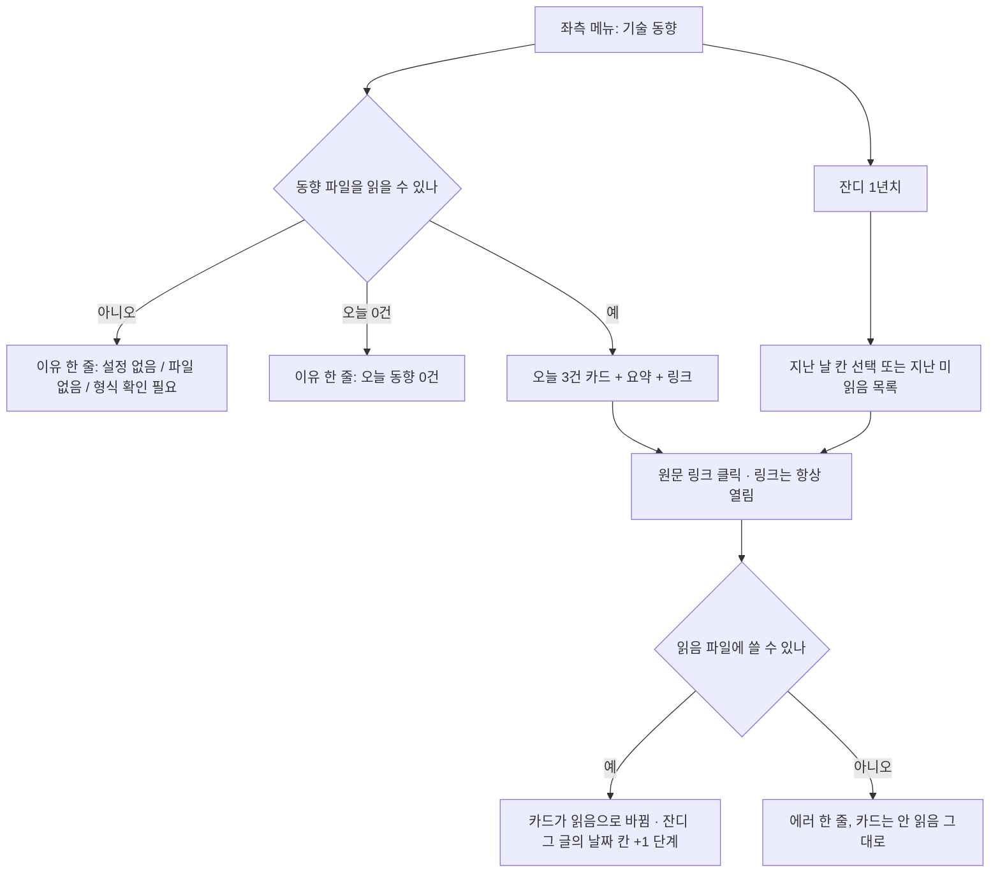

# PRD: desk-tech-trends (초안)

> 별도 작업이다. `desk-routine-inbox`(회고)와 파일·화면을 섞지 않는다. 요청은 wiki 세션에서 왔고(전문은 하네스가 막아 못 읽음, 미리보기 한 줄만 확인함), 결정은 Finn이 한다.

## 사용 장면 (Finn, 날것)

- 메뉴를 누르면 **오늘 동향 3건과 짧은 요약**이 바로 보인다
- 원문 링크를 누르면 **읽음으로 기록**된다(읽음 버튼은 없다)
- 잔디는 **읽었는지**를 보여 준다. 진하기는 그날 글을 몇 건 읽었는지(3건 · 2건 · 1건)에 따라 다르다
- 잔디 모양은 GitHub 기여 그래프 방식(1년치)

## 왜 · 성공지표

- 왜: 기술 최신동향을 매일 3건 읽는 습관을 desk 안에서 이어 가고, 얼마나 읽었는지를 잔디로 본다
- 성공지표: **첫 2주 동안 링크 클릭으로 쌓인 읽음 건수**(읽음 파일 줄 수). 비포 값은 없다 — 이 기능이 읽음 기록을 처음 만들기 때문에 이미 있는 숫자가 없다. `미측정: 읽음 파일 줄 수를 세는 한 줄 명령 / 배포 후 2주`
- 비포를 재는 작업인가: 아니오(바뀌기 전에 이미 있는 숫자가 없어 기록을 늘리지 않는다)

## 사용자 흐름

시나리오: ① 오늘 3건을 열고 원문 링크를 누른다 ② 오늘 일부만 읽고 닫는다 ③ 며칠 못 읽고 나중에 지난 날 글을 읽는다 ④ wiki가 파일을 안 써서 오늘 동향이 없다

## 결정

| 주제 | 결정 | 결정 주체 | 이유 |
|---|---|---|---|
| 동향이 desk에 오는 길 | **wiki가 파일에 쓰고 desk가 읽는다.** desk는 인터넷에서 가져오지 않는다 | Finn (A 선택, 이유 미기재) | AI: 회고 우편함과 같은 방식이라 읽기 규칙을 재사용한다. desk가 외부 호출과 요약 만들기를 안 맡고, 이 레포의 표준 라이브러리만 쓰는 규칙에 걸리지 않는다. 대신 wiki가 매일 아침 파일을 써 줘야 한다 |
| 읽음 표시 | **원문 링크를 누르면 읽음으로 기록되고, 확정이며 취소하지 않는다. 읽음 버튼은 두지 않는다** | Finn (B 선택, 2026-11-12 링크 클릭으로 변경) | Finn: 읽은 걸 취소할 일은 없다. AI 지적: 실수로 누르면 못 고친다. 필요해지면 취소 줄을 덧붙이는 방식으로 나중에 연다 |
| 메뉴를 열 때 | **오늘 3건과 요약이 바로 보인다.** 메뉴를 연 것만으로는 읽은 것이 아니고 원문 링크를 눌러야 읽음이다 | Finn(열자마자 보임, 링크 클릭=읽음)  | 열기만 해도 잔디가 차면 "읽음"이 뜻을 잃는다 |
| 잔디 단계 | **그날 읽은 건수 그대로 4단계(0 · 1 · 2 · 3건).** 3건을 넘기는 날도 3단계가 최고. 비율로 계산하지 않는다 | Finn (A 선택) | Finn: 건수 그대로가 단순해서. AI 지적: wiki가 2건만 보낸 날은 다 읽어도 최고 단계가 안 나온다 |
| 잔디 기간 | **1년치(GitHub 방식)** | Finn (A 선택) | Finn: 년 단위로 회고하기 좋고 친숙해서. AI 지적: 쓰기 시작한 처음 몇 주는 대부분 빈 칸이다(감수) |
| 지난 날 글 | **못 읽은 날의 글도 나중에 읽을 수 있다** | Finn (B 선택) | Finn: 결국 읽은 게 중요하다. AI 지적: 안 읽은 글이 쌓이는 건 감수하는 것이고, 회고 우편함의 "쌓이면 피로"와 반대 방향이다(이 부분은 Finn이 명시적으로 답하지 않음, AI 가정, 반려 가능) |
| 잔디 칸이 채워지는 날 | **글이 나온 날(`date`) 칸이 채워진다.** 읽은 날이 아니다 | Finn (B 선택) | Finn: 결국 읽은 게 중요하다. AI 지적: 잔디가 "그날 읽었나"가 아니라 "그날 몫을 결국 읽었나"를 뜻하고, 바로 읽은 것과 한참 뒤 읽은 것이 같은 색이다. 과거 칸이 나중에 바뀐다 |
| 파일 · 줄 모양 | **JSON Lines 두 파일: 동향 파일(wiki가 씀), 읽음 파일(desk가 씀).** 동향 줄 `{id, date, title, url, summary}` · 읽음 줄 `{id, at}`. id는 날짜를 포함한 해시이고 wiki가 만든다. 경로는 `config.json`의 `trends_items` · `trends_reads` 두 키 | AI 가정, 반려 가능 (Finn이 다음 질문에 이의 없이 답함) | AI: 서로 같은 파일에 쓰지 않아 동시 쓰기 충돌이 없다. 회고 우편함과 같은 규칙이라 파서·원자 쓰기를 재사용할 수 있다(구현 때 확인) |
| 같은 글을 두 번 읽음 | **글 id당 한 번만 센다.** 읽음 파일에 이미 있으면 줄을 덧붙이지 않는다 | AI 가정, 반려 가능 | 같은 글을 여러 번 눌러도 잔디가 3건을 넘게 차지 않게 한다 |
| 동향 파일에 없는 id | **읽음 파일에 있어도 동향 파일에 없는 id는 세지 않는다** | AI 가정, 반려 가능 | 글이 사라지거나 id가 틀려도 잔디가 거짓으로 차지 않는다 |
| 오늘 동향이 없을 때 | 에러가 아니라 이유 한 줄을 보인다(설정 없음 / 파일 없음 / 형식 확인 필요 / 오늘 동향 0건). 이유를 구분한다 | AI 가정, 반려 가능 | 조용히 비어 보이면 안 된다(회고 화면과 같은 규칙) |
| 읽음 파일을 못 쓸 때 | **`trends_reads`가 비어 있으면 목록은 보이고 링크도 열리지만 읽음은 기록되지 않는다고 카드에 이유를 보인다.** 쓰기가 실패하면(경로 없음·권한) 링크는 열고 카드에 에러 한 줄을 보이고 안 읽음으로 남긴다(Finn A). 읽음 파일이 아직 없을 뿐이면 첫 읽음 때 만든다 | Finn(쓰기 실패 시 링크는 열기 A) / 나머지 AI 가정, 반려 가능 | 기록이 안 남았는데 읽음으로 보이면 잔디가 거짓으로 찬다 |
| 요약 · 링크 표시 | 응답 문자열은 `textContent`로만 그린다. 링크는 `http`·`https`만 열리게 한다 | AI 가정(CLAUDE.md의 저장형 XSS 규칙) | wiki가 쓴 파일이라도 화면은 받은 문자열을 코드로 해석하지 않는다 |
| 못 읽은 날 | **자동으로 건너뜀을 찍지 않는다.** 안 읽은 날은 그냥 0단계다 | AI 가정, 반려 가능 | 읽음은 눌러서만 생기고 그 칸이 곧 기록이라 건너뜀 줄이 필요 없다. 쓰기 경로가 하나(`/trends/read`) 줄어든다 |

## 수용 조건 (step의 먼저 쓰는 테스트 입력)

1. 동향 파일에 오늘 날짜 3건이 있으면 목록 응답에 3건이 제목 · 요약 · 링크 · 읽음 여부와 함께 온다
2. 원문 링크를 누르면 화면이 읽음 POST를 보내고 링크를 연다. 서버는 읽음 파일에 `{id, at}` 한 줄을 덧붙이고, 다음 목록 응답에서 그 글의 읽음 여부가 참이다
3. 같은 id로 읽음을 두 번 보내도 읽음 파일에 줄이 하나뿐이다
4. 동향 파일에 없는 id로 읽음을 보내면 거절한다(400대) 
5. 잔디 응답은 오늘을 끝으로 1년치 날짜를 주고, 칸마다 그날 글 건수(total)와 읽은 건수를 0~3으로 준다(3건 초과는 3). 툴팁이 「글 n건 중 m건 읽음」을 쓰려면 total이 필요하다
6. 지난 날 글을 읽으면 오늘이 아니라 그 글의 `date` 칸의 건수가 오른다
7. `trends_items`가 비었거나 파일이 없거나 깨졌을 때, 화면에 이유가 보이고 서버는 죽지 않는다. 깨진 줄은 건너뛰고 개수를 표시한다
8. 요약·제목에 `<script>`가 들어 있어도 화면에서 코드로 실행되지 않는다. `javascript:` 링크는 열리지 않는다
9. 읽음 쓰기는 `POST /pick`처럼 토큰 헤더와 입력 검증을 쓰고, GET은 파일을 바꾸지 않는다(ADR-009)
10. 화면: 좌측 메뉴에 새 항목이 있고, 누르면 오늘 3건과 잔디가 한 화면에 보인다. 잔디 칸 진하기가 4단계로 구별된다
11. `trends_reads`가 비었으면 목록 응답은 오되 읽음 기록 가능 여부가 거짓이고 이유가 있다(화면은 링크를 그대로 열고 이유를 보인다). 읽음 POST는 400대로 거절한다
12. 읽음 파일에 쓰기가 실패하면 POST가 에러를 주고, 화면은 링크를 열고 카드에 에러 한 줄을 보이며, 다음 목록 응답에서 그 글은 읽지 않음으로 남는다. 읽음 파일이 없을 뿐이면 첫 읽음 때 만들어진다
13. 메뉴는 「기술 동향」 그룹 아래 「오늘」 · 「안 읽은 글」 두 하위 항목이다. `/nav-counts`가 안 읽은 건수(지난 날 포함, 동향 파일에 있는 글 중 읽음 파일에 없는 것)를 주고, 「안 읽은 글」 항목에 배지로 보인다. 0건이면 배지를 숨긴다. 이 건수를 못 구하면 다른 메뉴 건수는 그대로 오고 이 항목 배지만 숨긴다
14. 「안 읽은 글」 화면은 지난 날 안 읽은 글을 전체 날짜 내림차순으로 모두 보이고(페이지 나누기 없음, Finn A), 링크를 눌러 읽으면 그 줄이 빠지고 해당 날짜 잔디 칸이 오른다

## 비목표

- desk가 인터넷에서 글을 가져오기 · 요약을 만들기
- 읽음 버튼, 읽음 취소, 메모, 별점, 검색
- 기간 선택(잔디는 1년 고정), 비율 계산, 자동 건너뜀
- 폰 화면(`desk-phone-scope`)

## 아직 열린 것

- 같은 날 wiki가 파일에 동향을 덧붙여 건수가 바뀌는 경우의 표시(구현 때 가장 단순하게)
- 잔디 칸 색 4단계의 실제 값(디자인 단계, 기존 `DESIGN.md` 토큰을 재사용)
